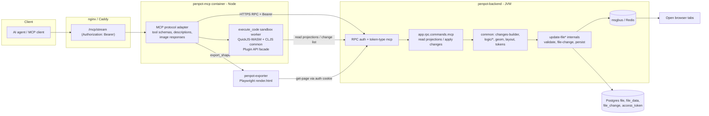

# Plan: browser-free Penpot MCP that writes directly to the backend

Status: proposal for review. Date: 2026-11-03. Scope: `penpot/mcp`, `penpot/backend`, `penpot/common`, `penpot/exporter`.

All paths are relative to the `penpot` repository root unless stated otherwise. Line numbers were checked on the
current working tree. Statements that could not be confirmed in code are marked "Unverified:".

---

## 1. Summary and decision

**Decision (taken by the user):** replace the browser-relayed MCP with a backend-native MCP. The MCP server reads and
writes Penpot files through the backend (file reads, `update-file` change records, media upload, exporter) with no
browser tab, no Penpot plugin and no "MCP -> Connect" click.

**What changes for agents**

- An agent connects once with its MCP token and can work on every team, project and file its profile can access.
  Today it can only touch the single file open in a connected tab.
- Tools take explicit `fileId` / `pageId` / `shapeId` arguments. There is no implicit "current file", "current page"
  or "selection".
- Writes are typed, validated batches of change records with an optimistic-concurrency revision (`revn`). The agent
  gets back the new `revn`, created IDs and a change count.
- Read tools return projections (outline, subtree, selected attributes) instead of whole files, so a 227 MB file is
  never shipped to the agent or to the MCP process.
- `execute_code` survives as a sandboxed server-side runtime with a Plugin-API-compatible facade (Section 6), so
  existing agent prompts and `penpotUtils` habits keep working for the covered subset.

**What is kept or demoted**

- The `/mcp/ws` plugin bridge (`mcp/packages/server/src/PluginBridge.ts`, `RedisBridge.ts`, `dispatch/*`,
  `mcp/packages/plugin/*`) is **kept long term, alongside backend mode, and is not deprecated**. It is selected with
  `PENPOT_MCP_MODE` (values `bridge`, `backend`, `both`; default `both`, see Section 3.4). It is not used in hosted
  multi-user deployments and is used for local single-user work and for anything that needs the real editor (for example visual verification against the live
  WASM renderer in a real tab, or Plugin API features the facade does not cover).
- The `sessionId` argument on every tool (`Tool.SESSION_ID_SCHEMA`) disappears in backend mode.

**Recommended architecture (detail in Section 3):** a new backend RPC namespace `app.rpc.commands.mcp` in Clojure
that reuses `common` directly (changes builder, geometry, layout, component sync, tokens), tagged
`::rpc/token-type "mcp"`. The TypeScript MCP server becomes a thin, authenticated protocol adapter (MCP schema, tool
descriptions, streaming, image handling) that forwards each tool call to one backend command.

---

## 2. Current architecture

### 2.1 Request path today

1. An MCP client calls `POST /mcp/stream?userToken=...` (nginx) which proxies to the MCP server `/mcp`
   (`docker/images/files/nginx-mcp-locations.conf.template` lines 9-13, query string forwarded with `$is_args$args`).
2. `McpAuthentication.authenticate` (`mcp/packages/server/src/McpAuthentication.ts` lines 70-108) extracts the token
   from `Authorization: Bearer` or `?userToken=`. Lines 95-100 state it **does not validate** the token; it only uses
   it to match the request to a plugin connection.
3. `PenpotMcpServer.setupHttpEndpoints` (`PenpotMcpServer.ts` line 307) runs the MCP handler inside an
   `AsyncLocalStorage` session context carrying the token.
4. Each tool builds a JavaScript snippet and calls `pluginBridge.executePluginTask(task, sessionId)`
   (for example `ExecuteCodeTool.ts` lines 70-78, `ExportShapeTool.ts` lines 150-166, `ImportImageTool.ts` lines 112-121).
5. `PluginBridge` (`PluginBridge.ts` line 68, WebSocket server line 103, token from query line 117) relays the task to
   the plugin in the browser. In multi-instance mode `RedisBridge` routes tasks between MCP replicas.
6. The plugin runs the code with `new Function(...)` against `penpot`, `penpotMgmt`, `penpotUtils`, `storage`
   (`mcp/packages/plugin/src/task-handlers/ExecuteCodeTaskHandler.ts` lines 25-31 and 78). It forces
   `flags.naturalChildOrdering` and `flags.throwValidationErrors` on (lines 45-52) and waits for
   `penpot.waitForLayoutUpdate()` first (lines 64-75).
7. The Plugin API implementation (`frontend/src/app/plugins/*.cljs`) emits workspace events which commit change
   records through the normal frontend persistence path to RPC `update-file`.

### 2.2 Current tool inventory

| Tool | File | What it does | Backend mode fate |
|---|---|---|---|
| `execute_code` | `tools/ExecuteCodeTool.ts` | Runs arbitrary JS against the full Plugin API in the tab | Replaced by sandboxed facade runtime (Section 6) plus typed tools |
| `high_level_overview` | `tools/HighLevelOverviewTool.ts` | Returns static instructions | Kept; text rewritten for backend tools |
| `penpot_api_info` | `tools/PenpotApiInfoTool.ts` | Returns Plugin API type docs (`ApiDocs.ts`) | Kept; docs filtered to what the facade supports, plus docs for typed tools |
| `export_shape` | `tools/ExportShapeTool.ts` | `shape.export()` in the tab, or raw fill bytes; `selection`/`page` aliases | Reimplemented on the exporter (`exporter/src/app/handlers/export_shapes.cljs`) and storage download |
| `import_image` | `tools/ImportImageTool.ts` | Reads a local file, uploads via `penpot.uploadMediaData`, creates a rect with image fill. Only registered when file system access is enabled (`PenpotMcpServer.ts` lines 266-268) | Reimplemented: `upload-file-media-object` (`backend/src/app/rpc/commands/media.clj` line 59) plus `add-obj`; also accept base64 and URL (`create-file-media-object-from-url`, line 239) for remote mode |
| `submit_feedback` | `tools/SubmitFeedbackTool.ts` | Calls `send-mcp-feedback` via `PenpotBackendClient` | Kept unchanged; already backend-native |

`dev/` tools (registered only when `PENPOT_MCP_DEVENV=true` and not multi-user, `PenpotMcpServer.ts` lines 273-280,
`shouldRegisterDeveloperTools` line 50):

| Tool | File | Scope decision |
|---|---|---|
| `cljs_repl` | `dev/CljsReplTool.ts` | **Out of scope.** Evaluates ClojureScript in the shadow-cljs dev build of the frontend via nREPL; a Penpot-developer tool, not a design capability. |
| `import_penpot_file` | `dev/ImportPenpotFileTool.ts` | **Replaced** by a supported `import_archive` tool on `import-binfile` (`binfile.clj` line 171) and the existing-file importer approach; the dev version depends on the CLJS REPL. |
| `cljs_compiler_output` | `dev/CljsCompilerOutputTool.ts` | **Out of scope.** Reads shadow-cljs compiler output; developer tooling only. |
| `clj_check_parentheses` | `dev/CljCheckParentheses.ts` | **Out of scope.** Source-code linting helper. |
| `read_taiga_issue` | `dev/ReadTaigaIssueTool.ts` | **Out of scope.** Reads the Penpot issue tracker; unrelated to file content. |

### 2.3 Backend facts relevant to the change

- **MCP token restriction.** `wrap-authentication` in `backend/src/app/rpc.clj` lines 171-216. Lines 186-197 raise
  `:token-auth-required` when `token-type` is `"mcp"` and the command does not declare `::rpc/token-type "mcp"`
  (lines 193-194). Only `send-mcp-feedback` declares it (`backend/src/app/rpc/commands/feedback.clj` line 36).
  Consequence: an MCP token cannot call `get-file`, `update-file`, `get-teams` or any other command today.
- **Token issuance.** `create-access-token` (`backend/src/app/rpc/commands/access_token.clj` lines 41-77) creates one
  MCP token per profile (deletes older ones, lines 27-31 and 74-75), issuer `urn:penpot:mcp-token`
  (`backend/src/app/http/access_token.clj` line 17), empty `perms`, `expires-at` nil when created by
  `ensure-mcp-access!` (`access_token.clj` lines 79-98, called with `nil` expiration on line 98). The OAuth path is
  `decision` / `token` in `backend/src/app/http/mcp_oauth.clj` (lines 186-218 and 244-287); line 209 calls
  `ensure-mcp-access!`; line 287 returns the fixed token as the OAuth access token.
- **Token validation.** `get-token-data` (`backend/src/app/http/access_token.clj` lines 38-48) checks the row exists,
  is unexpired, matches the profile and the issuer/type pair. `wrap-authz` (lines 50-80) attaches
  `::profile-id`, `::perms`, `::type` to the request. MCP tokens are accepted on `/api/main/methods/*` and
  `/api/rpc/command/*` because both routes set `::actoken/allow-mcp true` (`rpc.clj` lines 533 and 551).
- **Writes.** `update-file` (`backend/src/app/rpc/commands/files_update.clj` lines 154-272): edit permission check
  (line 171), per-file advisory lock `db/xact-lock!` (line 172), `vern` must match (lines 199-205), incoming `revn`
  must not exceed stored (lines 207-213), changes applied by `common` `process-changes`
  (`apply-changes` lines 504-513), validation (`process-changes-and-validate` lines 596-671), `file-change` row
  insert (lines 361-373), persist (line 375), msgbus notification to open tabs (`send-notifications!`, line 729;
  publishes `:file-change` with `session-id`). Concurrency limits `:update-file/by-profile` (1 permit, queue 5) and
  `:update-file/global` (20 permits) in `backend/resources/climit.edn` lines 16-19.
- **Reads.** `get-file` (`files.clj` lines 175-232) returns the whole file and realizes pointer maps when the client
  does not advertise `fdata/pointer-map` (lines 217-224). Cheaper reads already exist: `get-page` with `object-id`
  pruning (`get-page` fn line 405, command line 457, `prune-objects` line 383), `get-file-stats` (line 720), `get-file-tokens` (DTCG, line 765),
  `get-file-plugin-data` (line 742), `get-file-summary` (line 654), `get-file-libraries` (line 788).
- **Change records.** `common/src/app/common/files/changes.cljc`: schema `schema:change` at line 178;
  `process-changes` at line 521; methods `:add-obj` 619, `:mod-obj` 654, `:reorder-children` 684, `:del-obj` 690,
  `:reg-objects` 708, `:mov-objects` 764, `:add-page` 880, `:mod-page` 890, `:set-plugin-data` 927, `:del-page` 953,
  `:mov-page` 957, colours 961-969, media 975-983, `:add-component` 989 to `:purge-component` 1005, typographies
  1011-1019, `:set-tokens-lib` 1025, `:set-token` 1029, `:set-token-set` 1046, `:set-token-theme` 1061,
  `:set-tokens-status` 1079, `:set-own-tokens-status` 1084, token-set group moves 1091-1101, `:set-base-font-size`
  1108, `:set-tokens-source` 1112. `:add-obj` runs hard shape validation on the JVM only (line 622,
  `#?(:clj (validate-shape obj page-id))`).
- **Change builder.** `common/src/app/common/files/changes_builder.cljc` (`add-object` 445, `update-shapes` 570,
  `remove-objects` 690, `change-parent` 498, `add-component` 869, `set-token` 1010, `set-token-set` 1026,
  `set-token-theme` 1056, `set-tokens-status` 1070, `set-text-content` 1258, ...).
- **Business logic in `common` (`.cljc`, runs on JVM and JS).** `common/src/app/common/logic/libraries.cljc`
  (instantiate 243, detach 330, sync file/library 490/531, add component 2734, swap 2881, reset 2942, duplicate
  3265), `logic/shapes.cljc` (update 89, delete 238, relocate 456), `logic/tokens.cljc` (theme/set activation
  204-246, tokens source 27), `logic/variants.cljc`, `geom/modifiers.cljc` (`set-objects-modifiers` 325, flex/grid
  propagation 67-135), `files/shapes_builder.cljc` (SVG to shapes, `create-svg-shapes` 192),
  `types/path.cljc` (`update-bool-shape` 565, `convert-to-path` 586), `types/tokens_lib.cljc` (DTCG import 1757/1890,
  export 2009/2063).
- **Exporter.** `exporter/src/app/handlers/export_shapes.cljs` and `exporter/src/app/renderer/bitmap.cljs`: Playwright
  navigates to `render.html?file-id=...&page-id=...&object-id=...` with an `auth-token` cookie built from a token
  (lines 19-65). It renders from backend data; no editor tab is required.
- **Feature flags.** `common/src/app/common/features.cljc` lines 45-61 (supported), 79-87 (frontend-only, includes
  `render-wasm/v1`), 91-93 (backend-only `fdata/pointer-map`, `fdata/objects-map`).

---
## 3. Target architecture

### 3.1 Options

**(a) Tools in the TypeScript MCP server calling existing backend RPC.**
The MCP server downloads the file (`get-file`), decodes Transit, computes geometry and change records in TypeScript,
then posts `update-file`.

- For: no Clojure work; fast to start; the external importer proved `update-file` works with 2,446 shapes in
  300-shape batches (see Section 7.4).
- Against: TypeScript would have to re-implement `selrect`/`points`/`transform` derivation, flex and grid layout,
  component sync, variant logic, token application and SVG/boolean geometry that already exist in `common`.
  Every Penpot release would risk drift. Each write requires the whole file in the MCP process: for a large file
  (the ~227 MB Transit case that motivated this plan, background only) that is ~9-10 s TTFB before any edit. Validation errors surface late, as a
  backend rejection of the full batch.
- Variant (a'): load the ClojureScript build of `common` into the Node MCP server (`common` already compiles for
  Node: `common/shadow-cljs.edn` `:test` target `:runtime :node`, and the exporter bundles `../common`,
  `exporter/shadow-cljs.edn` line 3). This removes the duplication but keeps the "pull the whole file" cost.

**(b) New backend MCP RPC namespace in Clojure reusing `common`.**
`backend/src/app/rpc/commands/mcp.clj` (new) exposes a small set of commands (Section 5). Each loads the file inside
the backend with pointer-map lazy loading (`pmap/*load-fn*`, as `update-file*` does at `files_update.clj` lines
282-283), builds changes with `changes_builder`/`logic/*`, and commits them through the same internal path as
`update-file` (`update-file*`, validation, `file-change`, msgbus notification).

- For: exact parity with the frontend's own change generation, because it is the same `common` code; no 227 MB
  transfer (only touched pointer fragments are loaded); one transaction per tool call with the existing file lock;
  hard JVM validation (`changes.cljc` line 622) runs before commit; open tabs receive the same `:file-change`
  notification they get from a human collaborator.
- Against: Clojure work in the backend; must be careful not to bypass invariants that `update-file` enforces
  (features, `vern`, climit, audit, webhooks); reviewers must own two surfaces.

### 3.2 Recommendation

**Option (b)**, with the TypeScript MCP server as the protocol adapter. Reasons, in order:

1. Parity: the Plugin API implementation itself builds changes with `common` (for example `create-shape` in
   `frontend/src/app/plugins/api.cljs` lines 66-82 calls `cts/setup-shape` and `cb/add-object`). Running the same
   functions on the JVM gives the same records the plugin would have produced.
2. Performance: avoids shipping the file. Section 8 depends on this.
3. Safety: invariants (permissions, `vern`, feature checks, validation, notifications) stay in one place.

The `execute_code` facade (Section 6) is the one place where a JavaScript runtime is needed. It runs in a separate
Node worker process that holds the ClojureScript build of `common` (variant a') but **never pulls whole files**: it
calls the backend MCP commands for reads (projections) and sends the change list back to `mcp-apply-changes`.

### 3.3 Diagram

### 3.4 Process and deployment

- No new container. `penpot-mcp` gains backend-mode tools; `penpot-backend` gains `app.rpc.commands.mcp`
  (added to `resolve-methods`, `rpc.clj` lines 393-422).
- The MCP server already has `PENPOT_MCP_BACKEND_URI` (`PenpotMcpServer.ts` lines 269-272,
  `PenpotBackendClient.ts`). Backend mode reuses it; in the compose file this should point at the internal backend
  service, not the public URL, to keep traffic off the reverse proxy.
- The whole plan runs fully locally: development, testing and all performance testing use the local devenv
  (`penpot/docker/devenv`, `manage.sh`). Nothing in the plan depends on the Azure deployment. The Azure deployment is
  only a later, optional rollout target.
- Env flag `PENPOT_MCP_MODE` with values `bridge`, `backend`, `both` (default `both`). `both` runs the plugin bridge
  next to backend mode. `bridge` keeps the bridge only (see Section 1). `backend` runs backend mode only. This replaces
  the earlier `PENPOT_MCP_PLUGIN_BRIDGE` flag.

---

## 4. Auth and permissions

### 4.1 Real token validation in the MCP server

Today `McpAuthentication.ts` (lines 95-100) trusts any well-formed string. In backend mode the token is the only
credential, so:

1. On each new MCP session (and at most every 60 s per token afterwards), call a new backend command
   `mcp-whoami` (tagged `::rpc/token-type "mcp"`), returning `{profile-id, fullname, email-hash, scopes,
   expires-at, token-id}`. A 401 is mapped to an MCP `401` with `WWW-Authenticate` (already implemented in
   `rejectOAuth`, lines 110-120).
2. Cache the result in-process keyed by a SHA-256 of the token (never the raw token) with a 60 s TTL, so revocation
   takes effect within a minute without a backend round trip per tool call. The backend still re-validates every
   RPC (`get-token-data`, `http/access_token.clj` lines 38-48), so the cache is an optimisation, not a trust boundary.
3. Forward the token to the backend as `Authorization: Token <token>` (`PenpotBackendClient.ts` line 50 already does
   this for feedback). Verified: `http/middleware.clj` line 340 accepts both `Token` and `Bearer` schemes for access
   tokens, so either header form works.

### 4.2 Mapping token to profile

The backend already maps token to profile (`wrap-authz` sets `::actoken/profile-id`, `http/access_token.clj` line 72,
read in `make-rpc-handler`, `rpc.clj` line 103). No MCP-side mapping is needed beyond the cache above. Every backend
MCP command receives `::rpc/profile-id` and must call the existing permission helpers.

### 4.3 Commands to tag for the `mcp` token type

The rule at `rpc.clj` lines 193-194 is kept: MCP tokens stay denied on everything not explicitly opted in. Two ways
to grant access; the plan uses **both**:

- **New `mcp-*` commands** (Section 5) are tagged `::rpc/token-type "mcp"`. They are the main surface.
- **A short allow-list of existing read and dashboard commands** so the TS adapter can reuse them without wrapper
  code. Because `::rpc/token-type "mcp"` on an existing command would make it *require* an MCP token (rule at lines
  186-192 rejects session users), add a new metadata key `::rpc/allow-token-types #{"mcp"}` and change the third
  clause of `wrap-authentication` to `(and (= token-type "mcp") (not= required-token-type "mcp")
  (not (contains? (::allow-token-types mdata) "mcp")))`. Commands to opt in:

| Command | File / line | Scope |
|---|---|---|
| `get-profile` | `rpc/commands/profile.clj` 126 | read |
| `get-teams`, `get-team` | `rpc/commands/teams.clj` 196, 243 | read |
| `get-projects`, `get-all-projects`, `get-project` | `rpc/commands/projects.clj` 111, 126, 175 | read |
| `get-project-files`, `get-team-recent-files`, `get-file-info`, `search-files` | `files.clj` 307, 860, 923; `search.clj` 77 | read |
| `get-file-stats`, `get-file-summary`, `get-file-tokens`, `get-file-plugin-data`, `get-file-libraries`, `get-team-shared-files` | `files.clj` 720, 654, 765, 742, 788, 634 | read |
| `get-page` | `files.clj` 457 | read (used by the exporter path too) |
| `get-comment-threads`, `get-comments` | `comments.clj` 232, 358 | read |
| `get-file-snapshots` | `files_snapshot.clj` 33 | read |
| `get-font-variants` | `fonts.clj` 64 | read |
| `create-team`, `update-team` (rename) | `teams.clj` 531, 764 | `manage:teams` |
| `create-project`, `rename-project`, `update-project-pin`, `delete-project` | `projects.clj` 213, 266, 244, 310 | `manage:projects` / `manage:delete` |
| `create-file`, `rename-file`, `set-file-shared`, `delete-file` | `files_create.clj` 81; `files.clj` 945, 1117, 1180 | `content:write` / `library:write` / `manage:delete` |
| `duplicate-file`, `duplicate-project`, `move-files`, `move-project` | `management.clj` 99, 177, 351, 420 | write |
| `link-file-to-library`, `unlink-file-from-library` | `files.clj` 1227, 1266 | `library:write` |
| `restore-deleted-team-files` | `files.clj` 1518 | write |
| `upload-file-media-object`, `create-file-media-object-from-url` | `media.clj` 59, 239 | write |
| `create-comment-thread`, `create-comment`, `update-comment-thread-status`, `delete-comment-thread` | `comments.clj` 471, 598, 558, 714 | comment |
| `create-file-snapshot`, `restore-file-snapshot` | `files_snapshot.clj` 83, 111 | write |
| `export-binfile`, `import-binfile` | `binfile.clj` 72, 171 | write (import), read (export) |

**Not opted in** (explicitly): `update-file` itself (agents must go through `mcp-apply-changes`, which adds typed
validation and audit; this also avoids agents forging `session-id`), `permanently-delete-team-files`, team
membership/role/invitation commands, access-token commands, webhook commands, `delete-team`, `leave-team`,
profile/password/email commands.

### 4.4 Enforcing team / project / file permissions

Every `mcp-*` command calls the same checks as the human path: `files/check-read-permissions!` /
`check-edition-permissions!` (`files.clj` lines 86-97), `projects/check-read-permissions!`,
`teams/check-read-permissions!`. Viewer-role members therefore get read-only access through MCP, exactly as in the
UI. Share-link permissions do not apply (MCP has no `share-id`).

**Team scope (decision 1).** An MCP token reaches all teams the profile belongs to. There is no per-team scoping at
consent time. Access is still checked per file, project and team on every call, so the token never grants more than
the user's own role in each team.

### 4.5 Scopes (read vs write)

MCP tokens are created with empty `perms` (`access_token.clj` line 69). Add scopes to the same `perms` array:
`mcp:read`, `mcp:write`, `mcp:manage` (teams/projects/files lifecycle), `mcp:delete`. The existing
`wrap-authentication` already enforces `::rpc/perms` against token perms (`rpc.clj` lines 205-211); commands declare
`::rpc/perms #{"mcp:write"}` etc.

**Scope enforcement (review fix 1).** Commands also declare a new RPC metadata key `::rpc/mcp-scope` with one of
`"mcp:read"`, `"mcp:write"` or `"mcp:manage"`. The check runs ONLY when the request authenticates with an access token
whose token-type is `"mcp"`. Session (browser) users are never affected. The existing `::rpc/perms` key and its
`token-auth-required` behaviour in `wrap-authentication` are unchanged. Commands without `::rpc/mcp-scope` stay rejected
for MCP tokens, as today. Tests: a session user can still call every tagged command; an `mcp:read` token is refused on
write commands; an `mcp:write` token is accepted.

**Raw-change refusals (review fix 6).** The MCP path never forwards `skip-validate`; it is forced to false. Within
`apply_raw_changes`, these change types are refused: `:set-tokens-lib` (use the token tools), `:purge-component`,
`:purge-typography` and `:purge-color` (use the delete tools, which snapshot). Extra checks: any change that references
media or library ids must reference ids owned by files the profile can access; `:mov-objects` across pages is validated
like a delete plus an add.

**Scope defaults (decision 2).** Existing tokens are granted `mcp:read` only: list, read, export and pull/download
data. They cannot edit pages, shapes, tokens, components or anything else until the user grants `mcp:write`
explicitly, either by re-consenting through the OAuth screen or by a settings toggle. Newly created tokens start with
`#{"mcp:read"}` and receive `mcp:write` only through the same explicit grant. `mcp:manage` and `mcp:delete` are never
implied by `mcp:write`; they must be granted separately (extend `scopes_supported`, `http/mcp_oauth.clj` lines 51 and
60, and the `scope` check at line 136). Tokens with empty `perms` created before this change are treated as
`mcp:read` only. The `mcp:write` requirement applies to every tool marked "write" in Section 5.2, including
`apply_operations`, `apply_raw_changes`, `import_*`, and `manage_files` mutations.

### 4.6 Expiry, revocation, rotation

- `ensure-mcp-access!` creates tokens with no expiry (`access_token.clj` line 98, `nil` expiration). Add a configurable
  default `:mcp-token-max-age` (proposal 90 days) applied there and in `create-access-token` for `type "mcp"`.
  `get-token-data` already honours `expires_at` (`http/access_token.clj` lines 31-36).
- Revocation already works by deleting the row (`delete-access-token`, `access_token.clj` line 132). Document it and
  add a "Revoke MCP access" button if the Settings UI lacks one (Unverified: check the frontend settings page).
- Rotation: regeneration deletes old MCP tokens (`sql:clean-old-mcp-tokens`, lines 27-31). Keep that.

### 4.7 Rate limiting

- Backend: add climit entries `:mcp-apply/by-profile` (permits 2, queue 10, timeout 60000) and `:mcp-apply/global`
  (permits 10, queue 50) in `backend/resources/climit.edn`, and reuse `:update-file/by-profile` (1 permit) inside the
  apply path, so one agent cannot starve human edits. Reads: `:mcp-read/by-profile` (permits 4).
- rlimit: add a per-profile window for MCP commands in `backend/resources/rlimit.edn` (today a single
  `[:default :window "200000/h"]`, line 3), proposal `"6000/h"` for `mcp-*`.
- MCP server: per-token token-bucket (default 10 req/s burst 20) before forwarding, returning MCP error text "rate
  limited, retry after N s". Export concurrency stays bounded by the existing
  `PENPOT_MCP_EXPORT_SHAPE_MAX_PARALLEL_REQUESTS` semaphore (`ExportShapeTool.ts` lines 58-81).

### 4.8 Audit logging

One structured audit event per tool call, emitted directly by the backend MCP command regardless of the
`audit-log`, `webhooks` and `telemetry` flags (review fix 10). Backend mode refuses to start if this audit sink is not
configured. The existing `wrap-audit` is not relied on for this: it is flag-dependent and is not the MCP audit trail.
Each event carries: `{event: "mcp-tool", tool, token-id (not the token), token-fp (first 8 chars of SHA-256),
profile-id, team-id, project-id, file-id, page-ids, change-count, change-types histogram, revn-before, revn-after,
duration-ms, result: ok|error, error-code}`. Use the existing audit pipeline (`app.loggers.audit`, wired in
`wrap-audit`, `rpc.clj` lines 226-237) with `::audit/replace-props`. The MCP server additionally logs the same
fields minus file content at info level; it already fingerprints tokens (`PenpotMcpServer.ts` line 102).

### 4.9 `?userToken=` leaks into logs

`McpAuthentication.ts` lines 86-94 accept the token as a query parameter, and the nginx template forwards it
(`nginx-mcp-locations.conf.template` line 10). Query strings land in nginx/Caddy access logs and proxy logs.

- Prefer `Authorization: Bearer` (already supported, lines 76-84). Document it as the only supported method for
  backend mode.
- Keep `?userToken=` behind `PENPOT_MCP_ALLOW_QUERY_TOKEN=false` (default false in backend mode) for clients that
  cannot set headers.
- Add an nginx `log_format` that strips the query string for `/mcp/` locations in the local devenv proxy
  configuration (`penpot/docker/devenv`). Azure is a later optional rollout and is not used as evidence here.
- Migration for `?userToken=` clients (review fix 14): accepted by default with a logged warning and redaction until
  Phase 4, then default off. The change is documented for users before the default flips.

---

## 5. Tool design

### 5.1 Principles

- Few composable tools plus batch tools. Target: about 20 tools, not hundreds.
- Every write tool takes `fileId` and `baseRevn`; returns `{revn, createdIds, changeCount, warnings, snapshotId?}`.
- **Scope column.** Every tool is marked `read` (needs `mcp:read`), `write` (needs `mcp:write`), `manage` (needs
  `mcp:manage`) or `delete` (needs `mcp:delete`). Tools 12-19 and 21-22 are write-capable where noted in the tables;
  `dryRun` calls need only `mcp:read` because nothing is committed.
- **Snapshot option (decision 3).** Every write tool accepts `snapshot?: true|false` (default: automatic, see below).
  Automatic snapshot: one snapshot per tool call (never per commit), taken inside `update-file*` through the existing
  `::snapshot` hook in the same transaction as the first commit, using the existing file-version command
  `create-file-snapshot` (`files_snapshot.clj` line 83). The trigger is that the call deletes anything, has more than
  100 operations (or more than 100 changes for `apply_raw_changes`), or the caller sets `snapshot: true`. Snapshots are
  created with `created-by "system"` and the label `mcp/<tool>/<ISO timestamp>/<request id>`. Before creating one, the
  backend prunes the file's `mcp/`-labelled snapshots so that at most 20 remain (oldest first); user snapshots are never
  pruned. The existing `::quotes/snapshots-per-file` quota still applies. If the snapshot is refused or fails, the whole
  write is aborted with a `snapshot-failed` error and nothing is committed. The tool result returns `snapshotId` when a
  snapshot was taken.
  `baseRevn` mismatch is not an error when the changes do not conflict (Section 7.7); it is reported.
- Every write tool supports `dryRun: true`: build and validate the changes, return the change summary and the
  validation result, do not commit.
- IDs are UUIDs. Agents may pass client-generated IDs (`"$tmp:name"` handles are resolved within one batch) so a
  batch can create a board and its children in one call.
- Coordinates are absolute page coordinates unless `relativeTo: "parent"` is set, matching Plugin API `x`/`y` versus
  `parentX`/`parentY`.

### 5.2 Tool list

Backend mechanism column: "RPC x" = existing command opted in (Section 4.3); "mcp-x" = new command in
`app.rpc.commands.mcp`; "changes: ..." = change types from `changes.cljc` produced inside the command.

**Discovery and reading**

| # | Tool | Purpose | Key inputs | Output | Backend mechanism |
|---|---|---|---|---|---|
| 1 | `whoami` | Identify the profile and scopes behind the token | none | profile id, name, scopes, token expiry | mcp-whoami |
| 2 | `list_teams` | Teams the user belongs to | none | `[{id, name, isDefault, role}]` | RPC `get-teams` |
| 3 | `list_projects` | Projects of a team (optionally deleted) | `teamId`, `deleted?` | `[{id, name, isDefault, pinned, fileCount}]` | RPC `get-projects`; `get-team-deleted-files` for trash |
| 4 | `list_files` | Files in a project, or search across a team | `projectId` or `teamId`+`query`, `deleted?` | `[{id, name, revn, vern, modifiedAt, isShared, features}]` | RPC `get-project-files`, `search-files` |
| 5 | `get_file_outline` | File metadata and page list with shape counts; libraries; token summary | `fileId` | `{revn, vern, features, pages:[{id,name,index,shapeCount}], libraries, tokens:{sets,themes,active}, components:count, colors:count, typographies:count}` | mcp-get-file-outline (reads `pages`, `pages-index` page names and counts lazily; reuses `cfs/calc-file-stats` as in `get-file-stats`, `files.clj` 695-718) |
| 6 | `get_page_tree` | Layer tree of a page or subtree, depth-limited, selected fields | `fileId`, `pageId`, `rootId?`, `depth?` (default 3), `fields?` (default id,name,type,x,y,width,height,parentId,componentId), `limit?` (default 500), `cursor?` | nodes plus `truncated` and `nextCursor` | mcp-get-page-tree (derefs only the requested page pointer, like `get-page`, `files.clj` 405-449) |
| 7 | `get_shapes` | Full attributes of specific shapes | `fileId`, `pageId`, `ids[]` (max 200), `fields?`, `includeChildren?` | shape maps in Plugin-API naming (camelCase) | mcp-get-shapes (`prune-objects`, `files.clj` 383) |
| 8 | `find_shapes` | Server-side search on a page or file | `fileId`, `pageId?`, filters: `type`, `nameRegex`, `componentId`, `hasToken`, `textContains`, `withinBoardId`, `colors` (colour values or library colour ids, so `replaceColor`/`shapesColors` are covered), `limit` | `[{id, pageId, name, type, path}]` | mcp-find-shapes |
| 9 | `get_library` | Local library: components (with variants), colours, typographies, media | `fileId`, `kinds?`, `limit?` | lists with ids, names, paths, main instance ids | mcp-get-library |
| 10 | `get_tokens` | Token sets, themes, active status, tokens (optionally resolved values) | `fileId`, `resolve?` | DTCG JSON or flat list | RPC `get-file-tokens` (`files.clj` 765); resolution in mcp-get-tokens (Section 7.5) |
| 11 | `generate_code` | CSS / HTML / SVG markup for shapes (parity with `generateStyle`/`generateMarkup`) | `fileId`, `pageId`, `ids[]`, `type: css|html|svg`, `includeChildren?` | text | Sandbox worker running the code-gen namespaces (Section 6.4) |

**Writing**

| # | Tool | Purpose | Key inputs | Output | Backend mechanism |
|---|---|---|---|---|---|
| 12 | `apply_operations` | **Main write tool.** Typed, validated operation list. Default: one tool call = one `update-file` transaction, capped at 2,000 operations or 8 MB of changes; over the cap the call is refused with a clear error. `allowSplit: true` opts into several commits (adaptive batches starting at 300 objects), with one snapshot per call (Section 5.1) and progress reported per commit. On failure the response returns the last committed `revn` and the index of the first failed operation | `fileId`, `baseRevn?`, `dryRun?`, `allowSplit?` (default false), `operations[]` (max 2,000 by default; see 5.3) | `{revn, createdIds map, changeCount, commits?, warnings, validation}`; on partial failure also `lastCommittedRevn`, `failedOperationIndex` | mcp-apply-operations: builds changes with `changes_builder` and `logic/*`, then the `update-file*` path |
| 13 | `batch_create_shapes` | Convenience: create a nested tree of boards/shapes/text from one JSON tree | `fileId`, `pageId`, `parentId?`, `tree` (nodes with `type`, props, `children`), `layout?` | ids map | Expands to `apply_operations` `create_*` ops server-side |
| 14 | `apply_raw_changes` | Raw change records exactly as `schema:change` (`changes.cljc` 178); available to any token with `mcp:write` (decision 8) | `fileId`, `baseRevn`, `changes[]`, `snapshot?` | as 12 | mcp-apply-changes: schema-checked with `cpc/check-changes` (`changes.cljc` 455), permission-checked, snapshot-protected (rule below), rate-limited and audit-logged with full change-type histogram, then `update-file*`. Requires `mcp:write`. The MCP path never forwards `skip-validate` (forced to false). Refused change types: `:set-tokens-lib` (use the token tools), `:purge-component`, `:purge-typography`, `:purge-color` (use the delete tools, which snapshot). Changes that reference media or library ids must reference ids owned by files the profile can access. `:mov-objects` across pages is validated like a delete plus an add |
| 15 | `manage_files` | Team/project/file lifecycle: create, rename, duplicate, move, delete, restore, share, link library | `action`, ids, `name?` | created/updated entity | RPC commands in Section 4.3 table |
| 16 | `import_image` | Upload an image and optionally create a rect with image fill | `fileId`, one of `base64`, `url`, `filePath` (local mode only), `mimeType?`, `pageId?`, `parentId?`, `x?`,`y?`,`width?`,`height?`, `createShape?` (default true) | `{mediaId, width, height, shapeId?}` | RPC `upload-file-media-object` (multipart, `media.clj` 59) or `create-file-media-object-from-url` (239); then `add-obj` |
| 17 | `import_svg` | SVG string to shapes (parity with `createShapeFromSvg[WithImages]`) | `fileId`, `pageId`, `parentId?`, `svg`, `x?`,`y?` | root group id | mcp-import-svg: `shapes_builder/create-svg-shapes` (`files/shapes_builder.cljc` 192); embedded images uploaded first |
| 18 | `import_archive` | Import a `.penpot` archive as a new file, or as pages into an existing file | `projectId` or `fileId`, `base64`/`url` | file ids / page ids | RPC `import-binfile` (`binfile.clj` 171) for new files; mcp-import-pages for existing files (Section 7.4) |
| 19 | `manage_versions` | List, create, restore, pin snapshots | `fileId`, `action`, `label?`, `snapshotId?` | snapshot list / id | RPC `get-file-snapshots`, `create-file-snapshot`, `restore-file-snapshot`, `lock-file-snapshot` |
| 20 | `comments` | List, create, reply, resolve, delete threads | `fileId`, `action`, `pageId?`, `position?`, `frameId?`, `content?`, `threadId?` | thread/comment | RPC commands in `comments.clj` |

**Rendering, docs and code**

| # | Tool | Purpose | Key inputs | Output | Backend mechanism |
|---|---|---|---|---|---|
| 21 | `export_shape` | PNG/JPEG/WEBP/SVG/PDF of a shape or page; or raw image fill bytes | `fileId`, `pageId`, `shapeId` (or `"page"`), `format`, `scale?`, `mode: shape|fill`, `filePath?` (local mode only; needs a local-filesystem flag, as in `PenpotMcpServer.ts` ~266-268) | image content or file path | Exporter `export-shapes` (`exporter/src/app/handlers/export_shapes.cljs`), authenticated with the MCP token (Section 7.6); `mode: fill` downloads the storage object directly |
| 22 | `execute_code` | Sandboxed Plugin-API-compatible JavaScript (Section 6) | `code`, `fileId`, `pageId?` | return value, console log, `revn` | Sandbox worker; reads via 6-10, writes via mcp-apply-changes |
| 23 | `high_level_overview` | Instructions | none | text | unchanged |
| 24 | `penpot_api_info` | Docs for facade types and typed tools | `type`, `member?` | text | unchanged code, new doc set |
| 25 | `submit_feedback` | Feedback | unchanged | unchanged | RPC `send-mcp-feedback` |

That is **25 tools** (11 read, 9 write, 5 rendering/docs/meta).

### 5.3 `apply_operations` operation vocabulary

Each operation is a small tagged object validated with a Zod schema in the adapter and a Malli schema in the backend.
Operations are executed in order against an in-memory working copy, so later operations see earlier results.

| Area | Operations | Built with |
|---|---|---|
| Pages | `create_page {id?, name, index?}`, `update_page {id, name?, background?, backgroundToken?}`, `delete_page`, `move_page {id, index}` | `cb/add-page` 238 (emits `{page}` form only, never `{id,name}` together, see Section 7.4), `cb/mod-page` 245, `cb/del-page` 347, `cb/move-page` 356 |
| Create shapes | `create_board`, `create_rect`, `create_ellipse`, `create_path {content | d}`, `create_text {characters | content, growType}`, `create_image {mediaId}`, `create_group {childIds}`, `create_boolean {boolType, childIds}`, `create_svg_raw` | `cts/setup-shape` (`types/shape.cljc` 714) then `cb/add-object` 445; groups via `logic/shapes` relocate; booleans via `path/update-bool-shape` (`types/path.cljc` 565) |
| Modify | `update_shape {id, props}` where props uses Plugin API names (`name`, `x`, `y`, `width`, `height`, `rotation`, `opacity`, `blendMode`, `hidden`, `blocked`, `proportionLock`, `constraintsHorizontal/Vertical`, `borderRadius*`, `fills`, `strokes`, `shadows`, `blur`, `backgroundBlur`, `exports`, `clipContent`, `showInViewMode`, `flipX/Y`, `layoutChild`, `layoutCell`, text props) | `cls/generate-update-shapes` (`logic/shapes.cljc` 89) with geometry through `gsh` transforms and `geom/modifiers.cljc` `set-objects-modifiers` 325 |
| Structure | `move_shapes {ids, parentId, index?}`, `reorder {parentId, ids}`, `delete_shapes {ids}`, `clone_shape {id, parentId?}`, `ungroup`, `flatten {ids}`, `make_mask {groupId}`, `remove_mask` | `cls/generate-relocate` 456, `cb/reorder-children` 1173, `cls/generate-delete-shapes` 238, `cll/generate-duplicate-changes` 3265, `path/convert-to-path` 586 |
| Layout | `set_flex_layout {id, dir, wrap, gaps, paddings, align*, justify*, sizing}`, `set_grid_layout {id, rows, columns, ...}`, `remove_layout`, `set_grid_cell {gridId, childId, row, column, rowSpan, columnSpan}` | layout attrs in `types/shape/layout`; children positions recomputed by `set-objects-modifiers` (Section 7.2) |
| Text | `set_text {id, characters}`, `set_text_style {id, range?, fontId, fontFamily, fontVariantId, fontSize, fontWeight, fontStyle, lineHeight, letterSpacing, textTransform, textDecoration, textAlign, verticalAlign, fills}`, `apply_typography {id, typographyId, range?}` | `cb/set-text-content` 1258, `txt/change-text` (as `createText`, `api.cljs` 411-414) |
| Components | `create_component {shapeIds, name?, path?}`, `instantiate_component {componentId, libraryFileId?, pageId, parentId?, x, y}`, `detach {ids}`, `swap_component {id, componentId}`, `reset_overrides {id}`, `update_main {id}`, `rename_component`, `delete_component`, `restore_component`, `duplicate_component` | `cll/generate-add-component` 2734, `generate-instantiate-component` 243, `generate-detach-instance` 330, `generate-component-swap` 2881, `generate-reset-component` 2942, `generate-sync-shape-inverse` 1135, `generate-rename-component` 1127, `generate-restore-component` 2795, `generate-duplicate-component` 205 |
| Variants | `combine_as_variants {ids}`, `add_variant {containerId}`, `add_variant_property`, `rename_variant_property`, `remove_variant_property`, `set_variant_property {componentId, pos, value}`, `switch_variant {id, pos, value}` | `logic/variants.cljc` `generate-add-new-variant` 18; `logic/variant_properties.cljc` `generate-add-new-property` 107, `generate-update-property-name` 17, `generate-remove-property` 39, `generate-update-property-value` 60, `generate-make-shapes-variant` 197. Combine/switch: port the frontend events in `frontend/src/app/main/data/workspace/variants.cljs` (Unverified: whether they are pure enough to move to `common`) |
| Library | `create_color`, `update_color`, `delete_color`, `create_typography`, `update_typography`, `delete_typography` | `cb/add-color` 788 .. `cb/delete-typography` 859 |
| Tokens | `create_token_set {name, active?}`, `update_token_set`, `delete_token_set`, `move_token_set`, `create_token {setId, type, name, value, description?}`, `update_token`, `delete_token`, `create_theme {group, name, sets[]}`, `update_theme`, `delete_theme`, `activate_theme`, `toggle_set`, `set_tokens_status {themeIds, setIds}`, `set_tokens_source {libraryId|null}`, `import_tokens_dtcg {json, mode: merge|replace}`, `set_base_font_size` | `cb/set-token-set` 1026, `cb/set-token` 1010, `cb/set-token-theme` 1056, `cb/set-tokens-status` 1070, `clt/generate-*` (`logic/tokens.cljc` 27-246), `ctob/parse-multi-set-dtcg-json` (`tokens_lib.cljc` 1757) |
| Apply tokens | `apply_token {shapeIds, tokenName | tokenId, properties?}`, `unapply_token` | Port of `toggle-token` (`frontend/src/app/main/data/workspace/tokens/application.cljs` 833) to `common` (Section 7.5) |
| Prototyping | `add_interaction {shapeId, trigger, action, delay?}`, `remove_interaction`, `create_flow {name, boardId}`, `remove_flow` | `cls/add-new-interaction` (`logic/shapes.cljc` 686), `cb/set-flow` 381 |
| Guides | `add_ruler_guide {pageId | boardId, orientation, value}`, `remove_ruler_guide`, `set_board_grid_guides {id, guides}` | `cb/set-guide` 363, shape `:grids` attr |
| Plugin data | `set_plugin_data {target: file|page|shape|component|color|typography, id, namespace, key, value}` | `cb/set-plugin-data` 290 (`:set-plugin-data` 927) |
| Align | `align {ids, axis, mode}`, `distribute {ids, axis}` | alignment helpers in `common/src/app/common/geom/align.cljc`, then `update_shape` |

### 5.4 How agents discover IDs

`whoami` -> `list_teams` -> `list_projects` -> `list_files` -> `get_file_outline` (pages with ids and counts) ->
`get_page_tree` (depth 2-3 first, then `rootId` drill-down) -> `get_shapes` for full attributes. `find_shapes` jumps
straight to shapes by name/type/component. All list results are paginated with opaque cursors.

### 5.5 Reading without pulling 227 MB

- Files using `fdata/pointer-map` store each page (and other large subtrees) as separate fragments; the backend
  loads them on demand (`pmap/*load-fn*` bound to `fdata/load-pointer`, as in `get-page`, `files.clj` 437-441).
  `mcp-get-page-tree` and `mcp-get-shapes` deref **one page pointer** and return a projection. Page names are inside the pointer: `enable-pointer-map` wraps every
  `pages-index` value whole (`backend/src/app/features/fdata.clj` line 334). So the outline tool would have to load
  every page fragment just to list names. Fix: page summaries (id, name, index, shape count) come from the existing
  file data (the page list plus per-page metadata), cached in the backend keyed by `(file-id, revn)`, with the existing
  `get-file-summary` path (`files.clj` ~654) as the source. No new core index table is added. A new `file_page_index`
  table was considered and rejected: it is a core write-path change that needs a migration and adds upstream-merge
  cost, and it must be kept in sync by every `update-file*` commit that touches pages or object counts.
- Projections are field-limited and depth-limited; defaults keep responses under 50 KB.
- Page-level response cache (Section 8.2) keyed by `(file-id, page-id, revn)`.
- Files without a pointer-map may exist in the wild (Unverified on this tree; check `file.features`). For such files the
  first MCP touch triggers a one-off pointer-map migration (`enable-pointer-map`, `backend/src/app/features/fdata.clj` line 328)
  through a management command run by the operator, not silently by an agent (Section 7.8).

---
## 6. The `execute_code` question

### 6.1 Options

**(a) Drop it, rely on typed tools.** Simplest and safest. Breaks every existing prompt, skill and agent habit built
on `penpot.createBoard()`, `penpotUtils.findShapes(...)`, `storage`, loops and conditionals. Loops over hundreds of
shapes become hundreds of tool calls or a very large `apply_operations` payload the model must assemble by hand.

**(b) Sandboxed server-side JS with a Plugin-API facade that compiles calls into change records.**
A Node worker hosts a QuickJS runtime compiled to WASM (`quickjs-emscripten`) per session. This is the chosen sandbox
(decision 9); `isolated-vm` is not chosen. Inside it, `penpot`, `penpotMgmt`,
`penpotUtils` and `storage` are facade objects whose property reads hit a working copy of the page(s) fetched through
`get_page_tree`/`get_shapes` projections, and whose writes append operations to a pending list. On return, the
pending list is sent to `mcp-apply-operations` (one transaction) and the call returns the script's return value.
Shape proxies mirror `frontend/src/app/plugins/shape.cljs` semantics (property names, validation messages).

**(c) Both.** Typed tools as the primary, documented surface; the facade for compatibility and for loops.

### 6.2 Recommendation: (c)

- Typed tools give agents predictable schemas, dry runs, small payloads and good errors.
- The facade preserves parity with today's `execute_code` for the large covered subset, which is what the "full
  feature parity" requirement means in practice.
- The facade must not be a second implementation of Penpot logic. It records **operations** (Section 5.3), not raw
  shape maps; all geometry, layout and component logic runs once, in the backend, in `common` on the JVM.
- Read-after-write inside one script (for example `rect.resize(10,10); return rect.width`) is served by applying the
  pending operations to the worker's working copy using the **ClojureScript build of `common`** (the same
  `changes_builder` / `logic` code, compiled for Node like the exporter does, `exporter/shadow-cljs.edn` line 3).
  The backend recomputes authoritatively on commit; the worker's preview only has to be close enough for control
  flow. If the commit result differs (for example layout reflow moved a child), the tool returns the backend values.

### 6.3 Sandbox rules

- One QuickJS-WASM runtime per MCP session, memory cap 128 MB, CPU time cap 10 s per call (configurable), no `require`,
  no network, no file system, no timers beyond the call. The asyncify build of `quickjs-emscripten` is used so that host
  calls can be async. Page data is fetched as projections on demand, with a per-run prefetch of the target page. The
  CLJS `common` build runs in the Node host, NOT inside QuickJS. All data coming from a script is untrusted: the host
  validates every call against the operation schema before it becomes a change. QuickJS runs in WASM with no native
  build, so it is portable to arm64 and gives strong isolation. The cost is slower execution; the performance plan (Section 8) includes
  sandbox start-up and per-call benchmarks. `storage` persists per session in the runtime heap and is dropped after
  30 min idle or on session close (today it persists for the life of the tab, `ExecuteCodeTaskHandler.ts` line 28).
- Each script has an implicit `fileId` (tool argument) and optional `pageId` (becomes `penpot.currentPage`).
  `penpotMgmt.openFile(id)` switches the implicit file **inside the script** and flushes pending ops for the
  previous file first.
- Hard limits: 5,000 operations per script, 20 pages loaded per script, 50 MB working copy.
- `console` capture behaves as today (`ExecuteCodeTaskConsole.ts`).

### 6.4 What the facade covers

| Plugin API area | Facade behaviour |
|---|---|
| `penpot.createBoard/Rectangle/Ellipse/Path/Text/Boolean`, `group`, `ungroup`, `flatten`, `createShapeFromSvg[WithImages]` | Emits `create_*`, `create_group`, `create_boolean`, `flatten`, `import_svg` ops; returns a proxy with a temp id |
| Shape property get/set (Section 5.3 list), `resize`, `rotate`, `clone`, `remove`, `setParentIndex`, `bringToFront` etc., `appendChild`, `insertChild` | `update_shape`, `move_shapes`, `reorder`, `delete_shapes`, `clone_shape` |
| `addFlexLayout`, `addGridLayout`, grid `addRow/addColumn/setRow/setColumn/removeRow/removeColumn/appendChild`, `layoutChild`, `layoutCell` | `set_flex_layout`, `set_grid_layout`, `set_grid_cell` |
| Components and variants (`library.local.createComponent`, `component.instance()`, `detach`, `swapComponent`, `resetOverrides`, `updateMain`, `switchVariant`, `combineAsVariants`, `Variants.*`) | Component and variant ops |
| Library colours, typographies, `applyToText`, `applyTypography`, `asFill`, `asStroke` | Library ops; `asFill`/`asStroke` are pure and run in the worker |
| Tokens (`library.local.tokens` catalog, sets, themes, `addToken`, `applyToken`, `applyToShapes`, `toggleActive`, `tokensSource`) | Token ops |
| `penpotMgmt.*` (teams, projects, files) | `manage_files` RPCs, executed immediately (not batched) |
| `uploadMediaUrl`, `uploadMediaData` | Immediate media RPC, returns `ImageData` |
| `shape.export`, `penpotUtils.exportImage` | Immediate exporter call (counts toward export semaphore) |
| `generateStyle`, `generateMarkup`, `generateFontFaces` | Runs `frontend/src/app/util/code_gen/*` in the worker. `markup_html.cljs` and `markup_svg.cljs` use `react-dom/server` (line 9 in each), which runs on Node. Unverified: whether they pull other browser-only namespaces; budget a spike |
| `penpotUtils.*` (`mcp/packages/plugin/src/PenpotUtils.ts`: `shapeStructure` 25, `findShapes` 87, `findShapeById` 168, `getPages` 177, `generateCss` 198, `getBounds` 214, `setParentXY` 251, `addFlexLayout` 270, `analyzeDescendants` 300, `importImage` 363, `exportImage` 435, `findTokensByName` 472, ...) | Port the file to the worker unchanged where it only uses the Plugin API; it then runs against the facade |
| `utils.geometry.center`, `utils.types.is*` | Pure functions in the worker |
| `file.validate()` | `dryRun` of pending ops, returns backend validation errors |
| `file.saveVersion`, `findVersions`, `FileVersion.restore/pin/remove` | Snapshot RPCs |
| Comments (`addCommentThread`, `findCommentThreads`, `reply`, `resolved`) | Comment RPCs |
| `waitForLayoutUpdate` | Flushes pending ops to the backend and resolves after commit; returns the recomputed values |
| `history.undoBlockBegin/Finish` | Accepted; groups pending ops into one commit (no UI undo stack exists headless) |
| `selection`, `viewport`, `openPage`, `openViewer`, `ui.*`, `on/off` events, `theme`, `localStorage`, `activeUsers`, `closePlugin` | Not applicable; see Appendix A for each reason. Getters return neutral values (empty selection, `null` viewport); setters throw a clear error naming the typed alternative |

---

## 7. Hard problems and how each is solved

### 7.1 Text layout without a browser

**Problem.** Text shapes carry `:content` (the rich-text tree) plus `:position-data` (per-run positioned boxes used
by the SVG renderer) and auto-sized `width`/`height` for `grow-type` `auto-width`/`auto-height`. Position data is
computed by the browser DOM: `frontend/src/app/util/text_position_data.js` uses `document.createRange()` and
`getClientRects()` (lines 17-22). The Plugin API's `createText` deliberately drops `:position-data` and asks the
workspace to reflow (`api.cljs` lines 408-427, `dissoc :position-data` line 415, `:text/reflow` line 424, WASM resize
lines 426-427). Common geometry only consumes position data (`common/src/app/common/geom/shapes/text.cljc` lines
14-40); it cannot produce it.

**Solution (three layers):**

1. **Write without `position-data`**, exactly like `createText` does. The data model allows it (migrations already
   drop it when stale, `common/src/app/common/files/migrations.cljc` lines 496-518). With the default
   `render-wasm/v1` renderer, which the local devenv can force for all users (a `disable-render-switch` flag in the devenv
   configuration `penpot/docker/devenv`, plus the team feature; Unverified: confirm the exact devenv flag), the WASM renderer lays out text itself from `:content`. Unverified:
   confirm the WASM renderer ignores missing `position-data` for display; the SVG renderer would show nothing until
   reflow.
2. **Approximate sizes server-side** for `auto-width`/`auto-height` so layout and selection boxes are sane on first
   open: a JVM text measurer using the font files in storage (`get-font-variants`, `fonts.clj` 64, and builtin fonts)
   with Java2D `TextLayout` / `LineBreakMeasurer` for line breaking. Store resulting `width`/`height`, `selrect`,
   `points`. Mark shapes with a transient flag so a later precise pass can overwrite them.
3. **Precise pass (reflow job).** After an MCP commit that created or edited text, enqueue a background job that
   opens the file in the exporter's headless browser (`exporter/src/app/browser.cljs`) with a small
   `reflow.html` route (new, in the frontend `render` bundle) that runs the normal text layout and WASM resize, and
   commits `mod-obj` changes for `position-data`/size. This reuses the exporter's existing Playwright pool and
   `auth-token` cookie mechanism (`renderer/bitmap.cljs` lines 21-29). A human opening the file before the job runs
   also triggers reflow in their tab (current behaviour), and the revn check makes the two converge.

`get_shapes` exposes `textLayoutState: approximate | exact` so agents know when sizes are estimates.

### 7.2 Flex and grid layout recomputation

**Finding.** Layout math is in `.cljc` and runs on both JVM and JS: `common/src/app/common/geom/shapes/flex_layout.cljc`,
`grid_layout.cljc` (and subfolders), driven by `common/src/app/common/geom/modifiers.cljc`
(`set-flex-layout-modifiers` 67, `set-grid-layout-modifiers` 106, `propagate-modifiers-layouts` 196,
`sizing-auto-modifiers` 282, `set-objects-modifiers` 325). No browser APIs are involved except child sizes that
depend on text (7.1).

**Solution.** After building the operation's changes, run `set-objects-modifiers` on the working objects for the
affected layout roots (`find-auto-layouts` 261), convert the resulting modifiers to `mod-obj` geometry operations, and
append them to the same commit, as the workspace does in its transform pipeline (Unverified: the exact frontend
function that turns modifiers into changes, likely `app.main.data.workspace.modifiers`; port the pure part to
`common` if it is not already there). Text children use the approximate size from 7.1 until the reflow job runs,
which then re-runs layout for their parents.

### 7.3 Component main/copy sync and propagation

**Finding.** Sync logic is in `common/src/app/common/logic/libraries.cljc`: `generate-sync-file` 490,
`generate-sync-library` 531, `generate-sync-shape-direct` 807, `generate-sync-shape-inverse` 1135,
`generate-sync-file-changes` 2910, `generate-sync-head` 2929. The backend's `:mod-obj` processing already marks
components modified when a main instance is touched (`process-touched-change`, `changes.cljc` lines 503-518).

**Solution.**

- **Same file:** when an operation modifies a main component's subtree, run `generate-sync-file` for that component
  in the same commit so copies on all pages update (this is what the workspace does after edits). Bound the cost:
  only components whose mains were touched (from `*touched-changes*`).
- **Other files using a shared library:** do not rewrite other files synchronously. The existing
  `:library-change` notification (`send-notifications!`, `files_update.clj` line 729) already tells open consumers;
  closed consumers show "library updated" on next open (`update-file-library-sync-status`, `files.clj` 1291).
  Provide an explicit `sync_library_consumers {libraryFileId, fileIds?}` operation that runs `generate-sync-library`
  per consumer file, one transaction per file, rate-limited.
- **Copies edited by the agent:** operations on copies set `touched` exactly as the workspace does, because
  `cls/generate-update-shapes` goes through the same `ctn/set-shape-attr` path.

### 7.4 Geometry derived fields

**Finding.** `add-obj` is hard-validated on the JVM (`changes.cljc` line 622) and requires a complete shape:
`selrect`, `points`, `transform`, `transform-inverse` (confirmed by the external importer, see below).
`cts/setup-shape` (`common/src/app/common/types/shape.cljc` line 714) computes all of them from `x/y/width/height`
and type, as the Plugin API does (`api.cljs` line 69).

**Solution.** Never accept raw geometry from agents in `apply_operations`; always derive via `setup-shape` and
`gsh` transforms. `apply_raw_changes` keeps the backend validation as the only guard.

**Lessons from the working external importer** (`C:\dev\kam-platform-poc\react-ui-template\docs\ai-skills\penpot\tools\penpot-import-archive.mjs`;
Unverified on this machine: the path was not found by workspace search because it is outside this workspace,
facts come from the brief and user memory): 2,446 shapes written via `update-file` in 9 batches of 300, all 200;
`add-obj` needs `selrect`, `points`, `transform`, `transformInverse`; `add-page` takes `{id,name}` or `{page}`, never
both (the schema at `changes.cljc` lines 252-257 makes all three optional; the rule is enforced elsewhere);
parents must precede children; `revn` comes from the previous response and `vern` from `get-file`; responses are
Transit. The backend design avoids all of these by construction (builder ordering, server-side revn handling, JSON
adapter), but the regression tests in Section 9 encode each one.

### 7.5 Token resolution and applying tokens to shapes

**Finding.** Token CRUD is plain change records (`:set-token` etc., `changes.cljc` 1025-1112) built by
`changes_builder` (1000-1170) and `logic/tokens.cljc`. Applying a token to a shape is **frontend-only** today:
`toggle-token` / `apply-token` in `frontend/src/app/main/data/workspace/tokens/application.cljs` (lines 695, 833)
resolve values with Style Dictionary (`frontend/src/app/main/data/style_dictionary.cljs`, npm `style-dictionary`
5.5.5 in `frontend/package.json` line 115) and `app.main.data.tokenscript`, then update shape attributes and the
shape's `:applied-tokens` map.

**Solution.**

1. **Resolution engine.** The MCP adapter (Node) resolves token values with the same resolver the frontend uses (the
   existing CLJS resolver, run in the Node sandbox worker) before it sends operations. The backend never calls the MCP
   container (no `POST /internal/resolve-tokens` design). The backend validates the resolved values like any other
   change. A JVM port of the resolver can be considered later if latency matters. Unverified: whether `style-dictionary`
   5 and `tokenscript` run unmodified on Node (Style Dictionary does support Node).
2. **Application.** Port the attribute mapping of `application.cljs` (`update-shape-radius` line 51 and siblings,
   the `token-properties` table) to `common/src/app/common/logic/token_application.cljc`, pure functions from
   `(shape, token-type, resolved-value, attrs)` to shape updates. Both the frontend and the backend MCP use it, which
   removes the duplication risk.
3. **Re-resolution on token change.** When a token value or the active theme changes, shapes with that token applied
   must update. The frontend does this on load and on theme change. Backend MCP runs the same propagation for the
   changed token names within the file, bounded per commit; very large files get a background job.

### 7.6 Thumbnails and exports

- **Thumbnails.** File and object thumbnails are generated by clients and stored through
  `files-thumbnails` commands (`backend/src/app/rpc/commands/files_thumbnails.clj`). After MCP writes, thumbnails are
  stale until someone opens the file. Add an exporter job that renders the first board of each modified page at
  thumbnail size after an MCP session goes idle for 60 s, and stores it via the same thumbnail commands. Low priority
  (Phase 3).
- **`export_shape`.** The exporter needs an `auth-token` cookie (`renderer/bitmap.cljs` line 28,
  `bw/create-cookies uri {:token token}`). Unverified: whether the cookie accepts an access token or only a session
  token. If only sessions: add a backend command `mcp-create-render-session` (MCP-tagged) that mints a short-lived
  (5 min), read-only, file-scoped render session for the exporter. This is a new read-only, file-scoped session type in
  `session.clj`, budgeted in Phase 2 (Section 10). The `render.html` route then loads data via
  `get-page`/`get-file` with that session. The exporter API call itself follows the format proven in user notes:
  `POST /api/export` with `{cmd :export-shapes, profile-id, wait true, exports [...]}`.
- WASM vs SVG output: the plugin export path uses the WASM renderer when `render-wasm/v1` is active
  (`frontend/src/app/plugins/shape.cljs` lines 1646-1660). The exporter has a WASM path too
  (`exporter/src/app/renderer/wasm.cljs`, `:is-wasm` param in `export_shapes.cljs` line 37). Pass `is-wasm true` for
  teams with `render-wasm/v1` so exports match what users see.

### 7.7 Concurrent edits with open browser tabs

**Finding.** `update-file` accepts an incoming `revn` lower than stored (only greater is rejected, lines 207-213) and
returns `:lagged` changes so the client can rebase (`get-lagged-changes`, line 694). Changes are applied to the
latest stored data, not to the client's base, so non-overlapping concurrent edits merge naturally; overlapping edits
are last-writer-wins per attribute. `vern` mismatch (a version restore) is a hard conflict (lines 199-205). Open tabs
receive `:file-change` messages over msgbus (`send-notifications!`, line 729) and apply them unless the
`session-id` is their own.

**Solution.**

- The MCP commit path uses a dedicated, stable `session-id` per MCP session (UUIDv5 of token-id + MCP session id),
  so tabs never mistake MCP changes for their own and do apply them live. Each tool call uses one stable MCP session
  id (UUIDv5 of the request id) across all of its commits, so the agent does not receive its own commits as lagged
  changes.
- Operations are built against the **latest** data inside the transaction (after `db/xact-lock!`), not against the
  agent's earlier read. `baseRevn` is used only to warn: if objects the operation reads were changed after
  `baseRevn` (detected from `file_change` rows between `baseRevn` and current), return `warnings: [{shapeId,
  changedBy}]`. Option `failOnConflict: true` turns warnings into errors.
- `vern` mismatch returns a clear error; the agent must re-read.
- Large MCP batches are split into commits of at most 300 objects (Section 8.3) so a human tab is not blocked for
  long by the per-file lock.
- Human tabs see MCP edits arrive in real time, the same as a collaborator. The audit event identifies the agent.

### 7.8 File migrations and feature flags

- **Migrations.** `update-file-data!` migrates files that need it before applying changes (`fmg/need-migration?`,
  `files_update.clj` lines 455-475). The MCP path reuses it unchanged. `check-version!` (`files.clj` line 70) rejects
  files newer than the backend.
- **Features.** `update-file` computes team features and checks client vs file features (lines 179-181, using
  `cfeat/check-client-features!` and `check-file-features!`). MCP commands declare the client feature set of the
  current frontend build (`supported-features` minus nothing, `features.cljc` lines 45-61) so the checks behave as for
  a modern browser. Frontend-only features (`render-wasm/v1`, text editor v2, lines 79-87) do not persist on files.
- **`components/v2`.** Required; MCP rejects files without it (they are pre-2.0 and must be migrated by opening in
  the UI or by an operator command).
- **`fdata/pointer-map` and `fdata/objects-map`.** Backend-only (lines 91-93). MCP benefits from pointer-map (lazy
  page load). For files without it, provide an operator script that enables it (`enable-pointer-map`,
  `backend/src/app/features/fdata.clj` line 328) during a maintenance window. Do not auto-migrate on agent read.
- **`render-wasm/v1`.** Affects text layout expectations (7.1) and export path (7.6).
- **`design-tokens/v1`, `variants/v1`, `layout/grid`.** Default-enabled (lines 64-73). MCP refuses token/variant/grid
  operations for teams that lack them and reports which feature is missing.

---
## 8. Performance plan

This section is a release requirement, not guidance. No phase ships without meeting its gates (8.9).

### 8.1 Targets and budgets

Measured at the MCP server boundary (tool call received to tool result sent), on the local reference environment (8.6),
with a warm JVM, for a "medium" file (20 pages, 5,000 shapes, pointer-map enabled) unless stated. Every result records
the local machine spec (8.6) so runs are comparable.

Latency targets are absolute on the reference spec (8 cores, 32 GB RAM, Docker limits recorded) AND must be no worse
than the plugin-bridge baseline measured on the same machine in the same run (8.5). Cold-cache rows are the first call
after a backend restart; warm rows are everything else.

| Tool class | Examples | p50 | p95 | p99 | Notes |
|---|---|---|---|---|---|
| Metadata read | `whoami`, `list_*`, `get_file_outline` | 40 ms | 120 ms | 250 ms | No page body decode; cached page summaries keyed `(file-id, revn)` (8.2 item 3) |
| Metadata read, cold cache | Same, first call after backend restart | 300 ms | 800 ms | 1.5 s | Summary build from existing file data and `get-file-summary` path |
| Page read | `get_page_tree` depth 3, `get_shapes` 50 ids, `find_shapes` one page | 150 ms | 400 ms | 800 ms | One page pointer deref; cached by `(file, page, revn)` |
| Page read, cold cache | Same, first call after backend restart | 400 ms | 1 s | 2 s | Measured separately; not averaged into warm rows |
| Page read, large file | Same, on the generated reference large file (8.6) with pointer-map | 400 ms | 1.2 s | 2.5 s | Must not approach today's 9-10 s `get-file` TTFB |
| Page read, large file without pointer-map | Same, generated reference file built without pointer-map | 3 s | 6 s | 10 s | Accepted only until the operator migrates it; tool warns |
| Small write | `apply_operations` 1-20 ops | 250 ms | 600 ms | 1.2 s | Includes validation, `file-change` insert, notification |
| Batch write | `apply_operations` / `batch_create_shapes` 300 objects | 1.5 s | 3 s | 5 s | One commit, one transaction |
| Snapshot-triggered write | `apply_operations` with one delete, or more than 100 operations, on the medium file | 1 s | 2.5 s | 4 s | Includes one `create-file-snapshot` (D2); snapshot overhead itself must stay under 500 ms p95 on the medium file; large-file cost is measured in S8 (8.4) |
| Bulk write | 5,000 shapes via `allowSplit: true` (about 17 commits of 300) | 25 s total | 45 s | 60 s | End-to-end, sequential adaptive batches; default single-call mode refuses over 2,000 operations or 8 MB (8.3) |
| Token write | 10 sets + 10 themes + 300 tokens, one call | 800 ms | 1.5 s | 3 s | No shape propagation |
| Token apply | 500 shapes, one token | 1.5 s | 3 s | 5 s | Includes resolution |
| Export | `export_shape` one board 1440x900 PNG | 2.5 s | 5 s | 8 s | Exporter warm pool; current browser path is the baseline |
| `execute_code` | 100-op script | 800 ms | 2 s | 4 s | Sandbox startup cached per session |

Resource budgets:

| Resource | Budget |
|---|---|
| Backend heap per in-flight MCP request | Page read: < 64 MB allocated; 300-object write: < 256 MB; never a full realized copy of a pointer-map file |
| Backend CPU | Sustained 20 concurrent agents on separate files: < 70% of the recorded CPU limit (8.6); MCP traffic must not raise human `update-file` p95 by more than 20% |
| MCP server (Node) RSS | < 512 MB baseline + 128 MB per active sandbox; hard cap 2 GB (fraction of the recorded Docker memory limit, 8.6) |
| Postgres | < 10 statements per page read; < 25 per write commit; no sequential scan on `file_change` (query by `file_id, revn` must use the existing index; Unverified: index name, check `migrations`) |
| Payload to agent | Default responses < 50 KB; hard cap 1 MB per response (truncate with cursor) |
| Snapshot | One snapshot per tool call (D2), taken in the same transaction as the first commit. Realise cost counts toward the write budgets above; measured by S8 on the large reference file | Medium file: < 500 ms p95 added per snapshot; large file: reported, with a gate set after the first measured run |
| Throughput | 30 write commits/s across files; 3 commits/s on a single file (the per-file lock serialises) |

### 8.2 Read strategy for large files

1. **Never use `get-file` in the MCP path.** It realizes pointers for clients that do not advertise `fdata/pointer-map`
   (`files.clj` lines 217-224) and returns the full data. The 227 MB / 9-10 s TTFB figure for file 346a1245 is the
   cost to avoid.
2. **New backend read commands are needed** (`mcp-get-file-outline`, `mcp-get-page-tree`, `mcp-get-shapes`,
   `mcp-find-shapes`). They load the file row without decoding data where possible (`bfc/get-file ... :load-data?
   false`, used by `get-file-with-summary`, `files.clj` 556) and deref only the pointer fragments needed.
3. **Cached page summaries** (Section 5.5, 11.1) so outlines do not deref any page. Summaries (page list and per-page
   metadata) are built from the existing file data and the existing `get-file-summary` path (`files.clj` ~654), then
   cached in the backend keyed by `(file-id, revn)`. No new core index table is introduced.
4. **Decoded-page cache** in the backend: Caffeine (or the existing `app.util.cache`, used in `rpc.clj` line 269)
   LRU keyed `(file-id, page-id, revn)`, max 512 MB total, entry TTL 10 min. Invalidated implicitly by `revn`. Writes
   by MCP warm it with the post-commit page. Measure hit rate; target > 80% for read-heavy agents.
5. **Projection on the server.** Field selection and depth limits are applied before Transit/JSON encoding. Shape
   maps are emitted in camelCase JSON (the adapter speaks JSON to the agent; Transit is used only between adapter and
   backend if it measures faster, see 8.5).
6. **`find_shapes` across a whole file** iterates page fragments one by one with early termination at `limit`, and is
   bounded by a 5 s budget; partial results are returned with `truncated: true`.
7. **Pointer-map migration for legacy large files** (operator task). Expected effect for the generated reference file without pointer-map: page reads drop
   from "decode 227 MB" to "decode one page". Track per-file `features` in the outline so agents and operators see it.
8. **HTTP-level caching**: `get-file` already supports ETags via `::cond/key-fn` (`files.clj` lines 166-173); add the
   same `cond` key to page reads so the adapter can revalidate cheaply.

### 8.3 Write strategy

- **Atomicity and caps (D5).** Default: one tool call equals one `update-file` transaction, capped at 2,000 operations
  or 8 MB of changes. Over the cap the call is refused with a clear error; nothing is committed. `allowSplit: true`
  opts into several commits. Adaptive batches start at 300 objects per commit (proven by the external importer: 9
  batches of 300 all 200): target commit time 1.5 s; halve on > 3 s, grow by 50% (max 1,000) on < 0.7 s. Each commit
  is atomic. With `allowSplit`, one snapshot is taken per call (D2), progress is reported per commit, and on failure
  the response returns the last committed `revn` and the index of the first failed operation. Partial application is
  possible only in this explicit opt-in mode; it is never the default.
- **Transaction cost.** Each commit: lock (`xact-lock!`), apply, validate affected, insert `file-change` (blob of all
  changes), persist modified pointer fragments only (`pmap/*tracked*`, `files_update.clj` line 282), notify. Measure
  each step with the existing timing hooks (`record-validation-timing`, lines 486-494) and the `l/dbg` timings
  already logged (lines 238-252).
- **Validation cost.** `validate-file-affected!` is proportional to affected shapes; `validate-file-schema!` can be
  proportional to the whole file (only runs with `file-schema-validation` flag, line 660). Keep schema validation off
  in production MCP commits unless the flag is set, as for humans. `dryRun` always runs affected validation.
- **`revn` contention.** The per-file advisory lock serialises commits on one file. With an agent and a human on the
  same file, the agent's 300-object commit holds the lock ~1.5 s; a human save waits at most that long. Gate: human
  save p95 increase < 500 ms while an agent bulk-writes (8.4 concurrency test C3).
- **climit.** The existing `:update-file/by-profile` permit is 1 with queue 5 (`climit.edn` lines 18-19). An agent's
  parallel tool calls on the same profile queue behind each other; the adapter serialises writes per (token, file)
  itself to avoid queue overflow errors and exposes "busy" rather than failing.
- **Change-log size.** `file_change` rows store the full change blob (lines 361-373) and expire after 1 hour
  (`deleted-at`, lines 304-305 and 364). 5,000-shape imports create ~17 rows of a few MB; acceptable. Monitor table bloat.
- **Snapshots (D2).** One snapshot per tool call, never per commit, created inside `update-file*` through the existing
  `::snapshot` hook in the same transaction as the first commit (RPC `create-file-snapshot`, `files_snapshot.clj`
  line 83). Trigger: the call deletes anything, has more than 100 operations, or sets `snapshot: true`. Label
  `mcp/<tool>/<ISO timestamp>/<request id>`, `created-by "system"`. Before creating, prune the file's `mcp/`-labelled
  snapshots to at most 20 (oldest first); user snapshots are never pruned. The `::quotes/snapshots-per-file` quota
  still applies. If the snapshot is refused or fails, the whole write is aborted with a `snapshot-failed` error.
  Snapshot cost is part of the write budgets and is measured by S8 (8.4).
- **Notification volume.** Each commit sends one `:file-change` message with all changes to open tabs. For 300-object
  commits the message may be large; measure tab apply time (C3).

### 8.4 Benchmarks and load tests

**Micro-benchmarks (per tool).** Criterium (JVM) benchmarks for each `mcp-*` command body on fixed fixture files, plus
end-to-end timings through the adapter. Run at 1, 10, 100, 300, 1,000 operations where applicable. Record p50/p95,
allocation per call (`-XX:+UnlockDiagnosticVMOptions` / JFR allocation profiling) and DB statement count
(`pg_stat_statements` delta).

**Scenario tests.**

| ID | Scenario | Pass criterion |
|---|---|---|
| S1 | Create 50 pages, each with 1 board | < 15 s total; file opens in frontend without errors |
| S2 | Create 5,000 shapes (mixed rect/ellipse/text/board, 4 levels deep, 30% in flex layouts) | Bulk budget in 8.1; zero validation errors; render identical to plugin-built twin (9.3) |
| S3 | 10 token sets, 10 themes, 300 tokens, apply 20 tokens to 500 shapes | Token budgets in 8.1; frontend shows applied tokens with correct values |
| S4 | 200 components (100 with 3 variants each), 1,000 instances, then edit 20 mains | Sync of copies in same commit; < 10 s for the edit step; copies match mains |
| S5 | Read-heavy agent on the generated reference large file (8.6): outline, 20 page trees, 200 `get_shapes`, 50 `find_shapes`, 10 exports, 30 min | p95 per class within the "large file" row; backend heap stable |
| S6 | Import a `.penpot` archive of 2,446 shapes into an existing file (reproduces the external importer) | < 30 s; object counts equal to source |
| S7 | `execute_code` script that builds a 12-column grid design system page (≈800 ops) | < 8 s; same result as the typed-tool version |
| S8 | Snapshot benchmark on the generated large reference file (8.6), with pointer-map: one delete-containing write and one `snapshot: true` write, each measured with and without the snapshot | Added snapshot time reported per call (p50/p95); gate set after the first measured run and recorded in the results; `mcp/` snapshot pruning keeps 20 |
| S9 | Hostile `execute_code` scripts: infinite loop, memory bomb, deep recursion | Each stops at the 10 s or 128 MB cap with a clean error; no leaked QuickJS runtime or Node RSS growth after 100 repetitions |

**Concurrency tests.**

| ID | Scenario | Pass criterion |
|---|---|---|
| C1 | N agents (1, 5, 10, 20) each writing to a different file | Throughput scales to 20 with p95 small-write < 1.2 s; no climit queue errors |
| C2 | N agents (2, 5) on the same file, non-overlapping shapes | No lost writes (all created ids present); p95 small-write < 3 s |
| C3 | 1 agent bulk-writing (S2) + 1 human browser tab editing the same file via Playwright script. Run against a production frontend build in the devenv, not the shadow-cljs dev build (D12) | Human edits all persist; human save p95 increase < 500 ms; tab shows agent shapes live with no reload; no console errors |
| C4 | 1 agent + 1 human editing the **same** shape attributes | Last-writer-wins per attribute, both sides converge to the same value after notifications; agent gets a conflict warning |
| C5 | 20 agents read-only on the generated reference large file | Backend heap peak < 80% of the recorded `-Xmx`; no GC pause > 1 s; human open time of another file not degraded > 20% |

**Agent profiles.** Each simulated agent in C1-C5 and the soak uses its own test profile and token, because rate
limits are per profile. Results record the profile count.

**Soak tests (D15).** The 4 h run is the release gate (8.9). The 12 h run is optional, before 1.0 only. Mixed workload
(70% reads, 25% small writes, 5% batch writes, 1 export/min) at 5 concurrent agents. Pass: backend heap after full GC within +10% of the 30-min mark; Node RSS within +15%;
no growth in open DB connections; `file_change` rows pruned as expected; sandbox count returns to zero when sessions
end.

### 8.5 Tooling

- **Load driver:** a Node harness (`mcp/packages/loadtest`, new) that speaks real MCP over Streamable HTTP using
  `@modelcontextprotocol/sdk` client, so tests cover the adapter, auth and serialization. k6 is a poor fit because
  MCP is session-based JSON-RPC over SSE; autocannon only covers raw HTTP. Use k6 additionally for raw backend RPC
  baselines (`/api/main/methods/mcp-*`) to isolate adapter overhead.
- **Scenario scripts** as JSON fixtures of tool calls, replayable at a configurable rate and concurrency.
- **Browser actor** for C3/C4: Playwright script logged in as a second user that performs edits through the real UI
  (reuse the exporter's Playwright dependency).
- **Seeding:** the generator in 8.6 creates the reference large file. A local seed step creates a dedicated team
  "mcp-perf" in the devenv, with fixture files built through the backend MCP itself (S1-S4 outputs become fixtures).
  Seeds are stored as `.penpot` archives in `mcp/packages/loadtest/fixtures/` so every run starts from identical data
  (`import-binfile`).
- **Results:** JSON per run (`{scenario, commit, machineSpec, p50, p95, p99, max, errors, heap, rss, dbStatements}`)
  written to `mcp/packages/loadtest/results/<date>-<commit>.json`. Results stay local and are committed as plain files
  only when reviewed. A small HTML report compares to the previous run and to the baseline.
- **Baseline against today's browser-relayed MCP:** run S1, S2 (reduced to 1,000 shapes), S3, a 30-min S5 and export
  with the current plugin bridge on the local devenv before any backend work starts, using a Playwright-driven tab with
  "MCP -> Connect". Record as `baseline-plugin-bridge.json`, including the local machine spec. The new path must be no
  slower than baseline on any scenario and at least 3x faster on S2 and S5 (expected, since there is no browser, no
  WebSocket relay and no full file load).
- **Sandbox benchmarks.** Measure QuickJS-WASM runtime start-up time, memory per session, and per-call overhead for
  facade calls (1, 100 and 1,000 operations per script). Record alongside the other results. Hostile-script
  benchmarks (S9) run infinite loops, memory bombs and deep recursion, and prove the 10 s and 128 MB caps stop them
  cleanly without leaking runtimes.

### 8.6 Environment

- **Reference environment: the local devenv only.** All development, functional tests, performance tests and
  benchmarks run on the local devenv (`penpot/docker/devenv`, driven by `manage.sh`). No second VM is used. Nothing in
  the plan depends on the Azure deployment or on production data.
- **Machine spec recorded with every result.** Each run records the host OS, CPU model and core count, RAM, Docker
  Desktop resource limits (CPU, memory), Postgres and backend JVM settings (`-Xmx`, `shared_buffers`), the Git commit,
  and the architecture (for example x86_64 or arm64 under emulation). Results from different specs are never compared
  directly. A run with an emulated architecture is labelled as such.
- **Reference large file: generated by us.** A seeded, deterministic generator script in the repo (for example
  `penpot/mcp/packages/loadtest/fixtures/gen-large-file.*`, run locally) builds the reference large file(s). Target
  content: many pages, about 100,000 shapes, deep nesting, many components and instances, token sets and themes, text
  and images, sized to be comparable to the ~227 MB transit case. The generator builds the `.penpot` archive directly
  with `common` builders, NOT through the system under test. It validates the archive against the file schema and
  imports it with `import-binfile`. The generator takes a fixed seed, so every run starts from identical data. Seed,
  generator version and output hash are recorded with the results. Production files, including file 346a1245, are never used
  for gates. 346a1245 is cited only as background for why large-file reads matter.
- **Pointer-map variants.** The generator emits two variants: with and without `fdata/pointer-map`. The first is the
  reference for 8.1 rows "large file"; the second is the reference for the "without pointer-map" row.
- Deallocation and schedules are not part of the plan. Perf runs happen on the developer machine during a test window.

### 8.7 Observability

Backend (Prometheus, `backend/src/app/metrics.clj`, endpoint `/metrics` line 125):

- `penpot_mcp_tool_duration_seconds{tool, outcome}` histogram (buckets 0.025 .. 60 s).
- `penpot_mcp_changes_total{tool, change_type}` counter; `penpot_mcp_objects_per_commit` histogram.
- `penpot_mcp_db_time_seconds{tool}` histogram (time inside JDBC per request, via a dynamic binding around `db/exec!`).
- `penpot_mcp_page_cache_{hits,misses,evictions}_total`, `penpot_mcp_page_cache_bytes` gauge.
- `penpot_mcp_conflicts_total{kind: revn_warning|vern|lock_timeout}`.
- `penpot_mcp_errors_total{tool, code}`.
- Existing `:rpc-main-timing` (`rpc.clj` line 395) and `:update-file-changes` / `:update-file-validation-timing`
  (`files_update.clj` lines 230, 486-494) continue to apply because MCP commits go through the same internals.

MCP server (new `/metrics` on the internal port, `prom-client`):

- `penpot_mcp_adapter_duration_seconds{tool}`, `penpot_mcp_backend_rpc_duration_seconds{command}`,
  `penpot_mcp_sandbox_active`, `penpot_mcp_sandbox_heap_bytes`, `penpot_mcp_auth_cache_{hits,misses}_total`,
  `penpot_mcp_rate_limited_total`, event-loop lag.

Exposure (D3): observability is an optional `observability` compose profile in the local devenv (`penpot/docker/devenv`).
It runs Prometheus and Grafana bound to `127.0.0.1` only. Both `/metrics` endpoints are scraped on the local network
of the devenv and are never routed publicly. Logs: structured JSON lines with `requestId` propagated from the adapter
to the backend via `X-Request-Id`.

### 8.8 CI regression checks

- Every PR touching `mcp/`, `backend/src/app/rpc/commands/mcp*.clj`, `common/src/app/common/files/*` or
  `common/src/app/common/logic/*`: run a reduced smoke benchmark of the five most important tools on a fixed fixture
  in CI. The job is informational only and is never a gate. It publishes timings and allocation per call as a
  comparison against the stored main-branch result. Release gates are taken ONLY on the local devenv (8.6, 8.9).
- Nightly: S1, S2 (1,000 shapes), S3, C2 on a CI-hosted compose stack; informational, published as artefacts.
- Weekly (or before release): full S1-S9, C1-C5 and the 4 h soak on the local devenv, on the recorded machine spec.
  These are the only runs that count toward 8.9.

### 8.9 Pass/fail gates before release

A phase is releasable only when all of these hold on the reference environment:

1. All p95 targets in 8.1 for the tool classes delivered in that phase.
2. No scenario or concurrency test fails its criterion.
3. 4 h soak passes (12 h before the 1.0 release).
4. New path at least as fast as the plugin-bridge baseline on every comparable scenario; 3x on S2 and S5.
5. Human-tab degradation under C3 within limits.
6. No P1 error in logs during the test window (5xx from `mcp-*`, validation failures on committed data, OOM).

---
## 9. Testing beyond performance

### 9.1 Unit tests per tool

- **Adapter (TypeScript, vitest, alongside existing `*.test.ts` in `mcp/packages/server/src/`):** schema validation per
  tool (valid/invalid inputs), error mapping from backend codes, auth header handling (Bearer only in backend mode,
  `?userToken=` rejected unless enabled), rate limiter, response truncation, image responses, sandbox limits (QuickJS
  memory and CPU caps).
- **Operation compiler (Clojure, `common/test/common_tests/`):** for each operation in Section 5.3, a test that the
  generated change list matches what the corresponding Plugin API function produces. Where the Plugin API path is in
  the frontend, extract the pure part to `common` and test it once.
- **Token application port:** table-driven tests from `token-properties` cases, cross-checked against the existing
  frontend tests for `application.cljs` (Unverified: location of those tests under `frontend/test/`).
- **Text measurer:** golden widths for a fixed font set versus browser measurements captured once with Playwright;
  tolerance 2 px for single lines.

### 9.2 Backend RPC tests (`backend/test/backend_tests/`)

New `rpc_mcp_test.clj` following `rpc_commands_mcp_feedback_test.clj` and `rpc_access_tokens_test.clj`:

- Each `mcp-*` command with an MCP token, a personal access token, a session, and no auth.
- Token-type rule: MCP token on a non-allow-listed command still fails (`rpc.clj` lines 193-194 behaviour kept).
- `::rpc/allow-token-types` opt-in works and does not lock out session users.
- Write commands: `vern` mismatch error, concurrent commits from two sessions, lagged-change warnings, `dryRun`
  commits nothing (`file.revn` unchanged), audit event emitted with expected props, `:file-change` message published
  with the MCP session id (mock msgbus).
- Encode the external-importer rules as regression tests: `add-page` with both `id/name` and `page` is rejected;
  child before parent is rejected or reordered; missing `selrect` on raw `add-obj` is rejected; 300-object commits
  succeed.
- Repair path (`rpc_file_update_repair_test.clj` style): an MCP commit on a file with pre-existing damage triggers the
  same auto-repair as a human commit.
- **Read-only scope tests.** A token with only `mcp:read` (the default for existing tokens, decision 2) can call every
  read tool and `dryRun` writes, and every write tool, `apply_raw_changes` included, returns a scope error with no
  `file_change` row. Granting `mcp:write` (re-consent or settings toggle) takes effect on the next call. `mcp:manage`
  and `mcp:delete` are not implied by `mcp:write`.
- **Snapshot tests (D2).** A tool call that deletes any object, has more than 100 operations (or changes for
  `apply_raw_changes`), or sets `snapshot: true` creates exactly one snapshot, taken in the same transaction as the
  first commit, and returns `snapshotId`. A multi-commit call (`allowSplit`) still creates one snapshot, not one per
  commit. Snapshot label is `mcp/<tool>/<ISO timestamp>/<request id>` with `created-by "system"`. `snapshot: false` on
  a bulk write is honoured only where the rule above does not require one. The 21st `mcp/` snapshot prunes the oldest,
  keeping exactly 20 per file; user snapshots are never pruned. The `::quotes/snapshots-per-file` quota applies. A
  refused or failed snapshot aborts the whole write with `snapshot-failed`, and nothing is committed. Snapshot cost is
  measured by S8 (8.4) on the large reference file.
- **Raw-changes tests.** `apply_raw_changes` is schema-validated, permission-checked, rate-limited and audit-logged
  (change-type histogram present in the audit event).

### 9.3 Round-trip tests

Goal: backend-written files open in the real frontend with no errors and render the same as plugin-written files.

1. For each scenario S1-S4 and each operation family, build the same design twice: (A) through the backend MCP,
   (B) through the legacy plugin bridge in a Playwright tab running the equivalent `execute_code` script.
2. Open (A) in the frontend with Playwright; assert no console errors, no "file repaired" notice, no validation
   errors (`file.validate()` via plugin), layer panel counts match.
3. Normalise and diff file data of A and B: ignore ids, `revn`, timestamps; compare shape attributes, geometry within
   0.01 px, component and token references. Text `position-data` is excluded until the reflow job has run, then
   compared within 1 px.
4. Render every board of A and B through the exporter (WASM and SVG paths) and compare PNGs with a perceptual diff
   (pixelmatch threshold 0.1, max 0.5% differing pixels).
5. Export A with `export-binfile` and re-import it; compare again.

### 9.4 Permission tests

- Viewer role: reads succeed, every write tool returns a permission error, no `file_change` row.
- Team scope: a token reaches every team the profile belongs to (decision 1); each call still checks the file, project
  and team role of that profile.
- Editor in team X cannot read or write team Y files, list Y projects, or find Y files via search.
- Scope tests: token with `mcp:read` only cannot write; `mcp:delete` needed for delete actions; scope downgrade takes
  effect within the 60 s adapter cache.
- Revoked and expired tokens fail at the backend on the next call regardless of adapter cache.
- Blocked or inactive profile tokens fail (mirrors the check in `feedback.clj` lines 41-48).

### 9.5 Migration tests

- Files at older migration versions (fixtures from `common/test` and older `.penpot` archives) are migrated on first
  MCP write exactly as on a human write; post-migration validation passes.
- Files without `fdata/pointer-map`: reads work (slow path), writes work, operator migration script converts them and
  page reads speed up as expected.
- Feature gating: a team without `design-tokens/v1` or `variants/v1` gets clear errors from token/variant operations.
- `vern` restore during an agent session: next write fails with `vern-conflict`; after re-read it succeeds.

---

## 10. Phased delivery

Effort is for one experienced Clojure + TypeScript engineer; "w" = weeks. Each phase ends with its perf gates (8.9)
for the tools it adds.

### Phase 0: baseline, scaffolding and spikes (3 w)

- Local perf setup on the devenv, seeded reference large file generator (8.6), fixtures, load harness, plugin-bridge
  baseline numbers (8.5), QuickJS-WASM sandbox start-up benchmarks.
- Generator (D15): builds the `.penpot` archive directly with `common` builders (not through the system under test),
  validates it against the file schema, and imports it with `import-binfile`. Seeded and deterministic; seed, version
  and output hash are recorded with results.
- `app.rpc.commands.mcp` namespace skeleton, `::rpc/allow-token-types`, `mcp-whoami`, adapter backend client with
  Bearer auth and token cache, `PENPOT_MCP_MODE` (values `bridge`, `backend`, `both`; default `both`).
- Four time-boxed spikes (D7), each with a go/no-go decision and a named fallback:
  - (a) modifiers-to-changes on the JVM. Fallback: a Node worker running the `common` CLJS build.
  - (b) QuickJS async host calls. Fallback: a synchronous facade over prefetched page projections only.
  - (c) `code_gen` on Node. Fallback: keep `generateStyle`/`generateMarkup` bridge-only.
  - (d) exporter authentication with an access token. Fallback: a short-lived read-only render session.
- Exit: baseline JSON stored; generator produces the reference large file deterministically; `whoami` works end to end
  on the local devenv with no browser; each spike has a recorded go/no-go and, on no-go, the fallback is adopted in the
  plan.

### Phase 1: useful slice (7 w)

Scope: auth (4.1-4.8 minus scopes UI), a minimal write grant (D4: an "Allow MCP to edit" toggle in Settings >
Integrations > MCP server that adds `mcp:write` to the user's token and removes it when off, plus the `mcp:write` scope
on the OAuth consent screen; the full scopes UI stays in Phase 3), discovery (`list_teams`, `list_projects`,
`list_files`, `get_file_outline`, `get_page_tree`, `get_shapes`, `find_shapes`), `manage_files`
(create/rename/duplicate/move/delete/restore), `apply_operations` with pages, boards, rect, ellipse, path, group, fills,
strokes, shadows, blur, opacity, constraints, plugin data, move/reorder/delete/clone, `batch_create_shapes`,
`create_text` with approximate sizing (D15; section 7.1 layers 1-2, which do not depend on layout), tokens (sets,
themes, tokens, status, DTCG import), library colours, `apply_raw_changes`, `dryRun`, audit, metrics. Page summaries
come from existing file data and `get-file-summary` (D11), not from a new index table.

Exit criteria: S1, S2 without layout and text styling, S3 without token application, C1, C2, C3 pass; round-trip 9.3
steps 1-3 pass for the covered operations, including `create_text` at approximate size; permission tests pass; an agent
can build 50 pages of boards and shapes plus 10 token sets/themes in a fresh file with no tab open.

### Phase 2: layout, text, components (9 w)

Scope: flex and grid layout with recomputation (7.2; rated Partial until the layout spike passes, D7), text styling and
measurement refinement (7.1 layers 1-2 beyond the Phase 1 approximate sizing), typographies, components (create,
instantiate, detach, swap, reset, update main; same-file sync is rated Partial until its spike passes, D7), variants,
`import_image`, `import_svg`, booleans, flatten, masks, `export_shape` via exporter (7.6, with the render session
budgeted here per D15), comments, versions.

Exit criteria: S2 full, S4, S5, S6, C4 pass; round-trip 9.3 including render diffs pass; `export_shape` parity with
today for PNG and SVG.

### Phase 3: parity and polish (8 w)

Scope: token application and propagation (7.5), `execute_code` sandbox with facade (Section 6), `generate_code`,
text reflow job (7.1 layer 3), thumbnails, library consumer sync, prototyping (interactions, flows), guides, align
and distribute, full scopes UI and token expiry, `import_archive` into existing files, query-token log scrubbing, and
an MCP resource subscription on `revn` (tracked item, D14).

Exit criteria: S7, full soak (4 h gate; D15) pass; Appendix A has no "Partial" row without an accepted gap; the plugin
bridge remains available and documented as a supported mode.

### Phase 4: hardening, documentation and rollout (1-2 w)

Hardening, docs and the query-token default flip (D14, section 4.9): `?userToken=` stays accepted by default with a
logged warning and redaction until this phase, then its default is switched off and the change is documented. This
phase is not a deprecation: the plugin bridge is kept (decision 4). Docs are updated for both modes, and
`penpot_api_info` docs are regenerated for the facade. Any later Azure rollout is an optional later rollout and out of
scope for this phase.

**Total: 26-32 engineer-weeks** (Phase 0 3 w, Phase 1 7 w, Phase 2 9 w, Phase 3 8 w, Phase 4 1-2 w). Phase 1 delivers the
first useful agent workflow after about 10 weeks.

---

## 11. Risks, mitigations and open questions

### 11.1 Risks

| Risk | Impact | Mitigation |
|---|---|---|
| Upstream Penpot changes `common` change/logic APIs | Rebase cost, subtle breakage | Keep MCP logic thin over `common`; round-trip tests in CI; track upstream releases |
| Text without browser layout looks wrong until reflow | Poor first impression, wrong layout sizes | Approximate JVM measurer; reflow job; `textLayoutState` flag; WASM renderer lays out from content |
| Token application drifts from the frontend | Different results in UI vs MCP | Move the mapping to `common` and have the frontend use the same code |
| Agent bulk writes starve human editors | Human saves slow or time out | Adaptive batches, per-file lock time budget, climit entries, C3 gate |
| MCP token leak gives write access to all of a user's teams | Data loss / exfiltration | Read-only default for existing tokens and explicit `mcp:write` grant (decision 2), scopes, expiry, revocation, Bearer-only, audit trail, automatic snapshots before deletes and batches over 100 operations (decision 3) |
| Sandbox escape in `execute_code` | Server compromise | QuickJS compiled to WASM (decision 9): no host bindings beyond facade, no FS/network, memory and CPU caps per run, dependency pinning; run the worker in its own process |
| Legacy large files without pointer-map | Slow reads, memory spikes | Operator migration; slow-path budget; per-request memory guard |
| Dependence on a remote perf environment | Results not reproducible, cost and access problems | All testing is local on the devenv with the generated reference file (decisions 5 and 6); machine spec recorded with every result |
| Plugin bridge and backend mode both maintained | Duplicate maintenance, behaviour drift | Bridge kept by decision 4; shared tool schemas and round-trip tests (9.3) cover both modes |
| Exporter cannot authenticate with access tokens | No `export_shape` | Short-lived render session command (7.6) |
| Divergence between facade preview and backend result | Scripts make wrong decisions | Preview uses the same CLJS `common`; return backend values after commit; document |
| Fork-specific changes conflict with upstream MCP work | Merge pain | Keep new code in new files (`mcp.clj`, new tools); minimal edits to `rpc.clj` and `McpAuthentication.ts` |
| Rejected option: a new core `file_page_index` table for page lookups | Core write-path change, migration and upstream-merge cost | Rejected. Replaced by a cached page summary in the backend keyed by `(file-id, revn)`, built from existing file data and `get-file-summary` |
| Snapshot restore discards concurrent human edits made after the snapshot | Silent loss of human work during a rollback | Warn in the restore response; show the revn gap before restoring; restore only with explicit confirmation; note in the operator guide |

### 11.2 Decisions

The user and orchestrator decided the following. Each one is reflected in the sections named.

1. **Team scope.** An MCP token reaches all teams the profile belongs to. No per-team scoping at consent time.
   Effect: Sections 4.4, 9.4. Each call still checks the role on the file, project and team.
2. **Default scope for existing tokens.** Read and pull only (`mcp:read`). Existing tokens cannot edit pages, shapes,
   tokens, components or anything else until the user grants `mcp:write` explicitly (re-consent or settings toggle).
   Effect: Sections 4.5, 5.2, 9.2, 9.4.
3. **Snapshots.** Automatic file snapshot before any write batch that deletes anything or exceeds 100 operations, plus
   an explicit `snapshot` option on write tools. Reuses Penpot's file-version mechanism. Keeps the last 20 agent
   snapshots per file. Effect: Sections 5.1, 5.2, 9.2, 11.1.
4. **Plugin bridge.** Kept long term, alongside backend mode, for local single-user use and for features that need the
   real editor. Not deprecated. Effect: Sections 1, 3.4, 10 (Phase 4), 11.1.
5. **No second VM.** The whole plan runs fully locally on the devenv. All development, testing and performance testing
   use it. Each result records the local machine spec. Azure is only a possible later rollout target. Effect: Sections
   3.4, 8.1, 8.4, 8.5, 8.6, 8.8, 10 (Phase 0), 11.1.
6. **Reference large file.** Built by a seeded, deterministic generator in the repo, run locally (many pages, about
   100k shapes, deep nesting, components and instances, token sets and themes, text and images). Production files,
   including 346a1245, are not used for gates; 346a1245 is background only. Effect: Sections 5.5, 8.1, 8.2, 8.4, 8.6,
   10 (Phase 0).
7. **Frontend changes allowed.** Token application and variant logic may move into `common`. Effect: Sections 7.5,
   Appendix A.9, A.11.
8. **`apply_raw_changes`.** Available to any token with `mcp:write`. It is not limited to an expert scope. It is still
   schema-validated, permission-checked, snapshot-protected (decision 3), rate-limited and audit-logged. Effect:
   Sections 4.7, 5.2, 9.2.
9. **Sandbox.** QuickJS compiled to WASM (for example `quickjs-emscripten`), not `isolated-vm`. Chosen for pure
   JS/WASM, no native arm64 build, strong isolation, and memory and CPU limits per run. Slower execution is accepted and
   measured in the performance plan. Effect: Sections 3.3, 6.1, 6.3, 8.4, 11.1.

**Remaining open questions.** None that block the plan. Items still to confirm during implementation are marked
"Unverified:" in the sections above (for example the snapshot RPC command name and the WASM text layout behaviour).

#### Review fixes applied

- D1 Scope enforcement: `::rpc/mcp-scope` (`mcp:read`, `mcp:write`, `mcp:manage`) checked only for `mcp` access tokens; session users unaffected.
- D2 Snapshots: one per tool call inside `update-file*`, `mcp/` labels, max 20 kept, failure aborts write with `snapshot-failed`; RPC is `create-file-snapshot`.
- D3 Fully local: Azure Monitor and the VM removed; optional `observability` compose profile bound to `127.0.0.1`; gates only on local devenv; CI smoke is informational.
- D4 Write grant in Phase 1: "Allow MCP to edit" toggle adds or removes `mcp:write`, plus consent-screen scope; full scopes UI in Phase 3.
- D5 Atomicity: one tool call equals one `update-file` transaction, capped at 2,000 operations or 8 MB; `allowSplit` opts into adaptive batches with per-call snapshot.
- D6 Raw changes safety: MCP forces `skip-validate` to false; refuses `:set-tokens-lib` and purge changes; checks media and library id ownership.
- D7 Honest ratings: flex/grid (A.6) and same-file component sync (A.9) rated Partial; four time-boxed Phase 0 spikes with fallbacks.
- D8 Token resolution: MCP adapter resolves token values; backend never calls the MCP container.
- D9 Sandbox model: asyncify `quickjs-emscripten`, on-demand page projections with per-run prefetch; `common` runs in Node host; script data untrusted.
- D10 Audit: MCP emits audit events regardless of feature flags; backend refuses to start without an audit sink.
- D11 No new core index table: `file_page_index` dropped; page summaries cached by `(file-id, revn)`.
- D12 Gates relative to a recorded machine: reference spec (8 cores, 32 GB); cold-cache rows; C3 run against production frontend build.
- D13 Effort: revised to 26-32 engineer-weeks (Phase 0 3 w, Phase 1 7 w, Phase 2 9 w, Phase 3 8 w, Phase 4 1-2 w).
- D14 Fixes 14-19: Unverified items closed; single `PENPOT_MCP_MODE` (default `both`); devenv refs replace Azure; Appendix A rows added; hostile-script benchmarks; `?userToken=` migration.
- D15 Other points: deterministic generator with `common` builders and `import-binfile`; 4 h soak gate; Phase 1 `create_text`; stable MCP session id per tool call; render session in `session.clj`.

---
## Appendix A. Coverage matrix

Sources: Plugin API types `plugins/libs/plugin-types/index.d.ts` (interface line numbers given), implementation
`frontend/src/app/plugins/*.cljs`, current MCP tools in `mcp/packages/server/src/tools/`, `penpotUtils` in
`mcp/packages/plugin/src/PenpotUtils.ts`. Tool numbers refer to Section 5.2. "ops" = `apply_operations` operation
(Section 5.3); every op is also reachable from `execute_code` (tool 22) through the facade.

Status: **Full** = same capability; **Partial** = works with the stated gap; **N/A** = not applicable headless, with
reason.

### A.1 Current MCP tools

| Capability | New tool | Backend mechanism | Status |
|---|---|---|---|
| `execute_code` (arbitrary Plugin API JS) | 22 `execute_code` + typed tools | Sandbox facade -> mcp-apply-operations | Partial: covers rows in A.2-A.16 marked Full/Partial; UI/session rows are N/A |
| `high_level_overview` | 23 | Static text | Full |
| `penpot_api_info` | 24 | `ApiDocs.ts` with facade doc set | Full |
| `export_shape` shape mode PNG/SVG | 21 | Exporter `export-shapes` | Full |
| `export_shape` fill mode | 21 | Storage object download by media id | Full |
| `export_shape` `shapeId: "selection"` | 21 | None | N/A: no UI selection headless; agent passes an explicit id |
| `export_shape` `shapeId: "page"` | 21 | Exporter on page root | Full |
| `import_image` (local file) | 16 | `upload-file-media-object` + `add-obj` | Full (local mode); remote mode adds base64/URL |
| `submit_feedback` | 25 | `send-mcp-feedback` | Full |
| dev `import_penpot_file` | 18 `import_archive` | `import-binfile` | Full |
| dev `cljs_repl`, `cljs_compiler_output`, `clj_check_parentheses`, `read_taiga_issue` | none | none | N/A: developer tooling, not design capabilities (Section 2.2) |

### A.2 File and page management (`File` 1891, `Page` 3491, `Context` 1046)

| Capability | New tool | Backend mechanism | Status |
|---|---|---|---|
| `currentFile` id/name/revn/pages | 5 | mcp-get-file-outline, cached page summary keyed by file-id and revn | Full (explicit `fileId`) |
| `currentPage`, `root` | 6 | mcp-get-page-tree | Full (explicit `pageId`) |
| `createPage` | 12 ops `create_page` | `:add-page` (`changes.cljc` 880) | Full |
| Page `name` set, background | 12 `update_page` | `:mod-page` 890 | Full |
| Page `remove` | 12 `delete_page` | `:del-page` 953 | Full |
| Page reorder | 12 `move_page` | `:mov-page` 957 | Full |
| `Page.getShapeById`, `findShapes` | 7, 8 | mcp-get-shapes, mcp-find-shapes | Full |
| `openPage` | none | none | N/A: navigation of a UI tab; agents pass `pageId` |
| `File.export('penpot'|'zip')` | 18 (export side) | `export-binfile` (`binfile.clj` 72) | Partial: `penpot` format Full; `zip` (SVG+JSON) Unverified backend support, may need the exporter |
| `File.findVersions`, `saveVersion`, `FileVersion.restore/remove/pin` | 19 | `files_snapshot.clj` 33, 83, 111, 170, 205 | Full |
| `File.validate()` | 12 `dryRun` | `validate-file-affected!` | Full |
| Page flows `createFlow`, `removeFlow` | 12 | `:set-flow` 566 | Full |
| Page `addRulerGuide`, `removeRulerGuide` | 12 | `:set-guide` 550 | Full |

### A.3 Shape CRUD by type (`createBoard` 1339, `createRectangle` 1319, `createEllipse` 1388, `createPath` 1402, `createText` 1459, `createBoolean` 1414, `group` 1253, `createShapeFromSvg` 1425)

| Capability | New tool | Backend mechanism | Status |
|---|---|---|---|
| Board | 12/13 `create_board` | `setup-shape :frame` + `:add-obj` 619 | Full |
| Rectangle | 12/13 `create_rect` | `:add-obj` | Full |
| Ellipse | 12/13 `create_ellipse` | `:add-obj` (`:circle`) | Full |
| Path (`content`, `d`, `commands`, `toD`) | 12 `create_path`, 7 | `:add-obj`, path types `common/src/app/common/types/path.cljc` | Full |
| Text | 12/13 `create_text` | `:add-obj` with `txt/change-text` | Partial: size approximate until reflow (7.1) |
| Image shape | 12 `create_image` | `:add-obj` `:image` | Full |
| Group / ungroup | 12 `create_group`, `ungroup` | `generate-relocate`, `:mov-objects` 764, `:reg-objects` 708 | Full |
| Boolean (union/difference/exclude/intersection) | 12 `create_boolean` | `path/update-bool-shape` | Full |
| SVG import (`createShapeFromSvg`) | 17 | `shapes_builder/create-svg-shapes` | Full |
| SVG import with images (`createShapeFromSvgWithImages`) | 17 | `shapes_builder/create-svg-shapes`; media upload commits outside `update-file` | Partial: media upload commit path; design pending |
| `SvgRaw` | 12 `create_svg_raw` | `:add-obj` `:svg-raw` | Full |
| `flatten` | 12 `flatten` | `path/convert-to-path` | Full |
| `remove` | 12 `delete_shapes` | `generate-delete-shapes`, `:del-obj` 690 | Full |
| `clone` | 12 `clone_shape` | `generate-duplicate-changes` | Full |
| `appendChild`, `insertChild`, `setParentIndex`, z-order methods | 12 `move_shapes`, `reorder` | `:mov-objects`, `:reorder-children` 684 | Full |
| Mask `makeMask`, `removeMask`, `isMask` | 12 | `:mod-obj` `masked-group` + `:reg-objects` | Full |
| `createVariantFromComponents` | 12 `combine_as_variants` | variant logic | Partial: depends on port of frontend combine logic (Section 5.3) |

### A.4 Geometry and transforms (`ShapeBase` 4011)

| Capability | New tool | Backend mechanism | Status |
|---|---|---|---|
| `x`, `y`, `parentX/Y`, `boardX/Y` | 12 `update_shape` | `gsh` transforms + `:mod-obj` 654 | Full |
| `resize`, `width`, `height` | 12 | `set-objects-modifiers` | Full |
| `rotate`, `rotation` | 12 | transform matrix via `gsh` | Full |
| `flipX`, `flipY` | 12 | modifiers | Full |
| `bounds`, `center`, `utils.geometry.center` | 7 | derived from `selrect`/`points` | Full |
| `proportionLock` | 12 | attr | Full |
| `alignHorizontal/Vertical`, `distributeHorizontal/Vertical` | 12 `align`, `distribute` | `geom/align.cljc` | Full |
| `waitForLayoutUpdate` | 12 (implicit) | layout recomputed inside the commit | Full |
| `bringForward`, `sendBackward` | 12 `move_shapes`, `reorder` | `:reorder-children` 684 | Full |

### A.5 Fills, strokes, shadows, blur, appearance (`Fill` 2042, `Stroke` 4519, `Shadow` 3954, `Blur` 192, `Gradient` 2310)

| Capability | New tool | Backend mechanism | Status |
|---|---|---|---|
| Solid / gradient / image fills | 12 `update_shape fills` | `:mod-obj` `:fills`; media refs collected (`changes.cljc` 606-617) | Full |
| Fill colour references to library colours | 12 | `fill-color-ref-id/file` attrs | Full |
| Strokes (align, cap, style, width, per-side) | 12 | `:mod-obj` `:strokes` | Full |
| Shadows (drop / inner) | 12 | `:mod-obj` `:shadow` | Full |
| `blur`, `backgroundBlur` | 12 | `:mod-obj` | Full |
| `opacity`, `blendMode`, `hidden`, `visible`, `blocked` | 12 | `:mod-obj` | Full |
| `borderRadius*` | 12 | `:mod-obj` radius attrs | Full |
| `exports` (export presets on shape) | 12 | `:mod-obj` `:exports` | Full |
| `shapesColors`, `replaceColor` | 8 + 12 | `colors` filter on `find_shapes` (tool 8), then `update_shape` | Partial: implemented as find + batch update; no single call |

### A.6 Flex and grid layout (`FlexLayout` 2096, `GridLayout` 2352, `CommonLayout` 658, `LayoutChildProperties` 2797, `LayoutCellProperties` 2756)

| Capability | New tool | Backend mechanism | Status |
|---|---|---|---|
| `addFlexLayout`, all flex props, `remove` | 12 `set_flex_layout`, `remove_layout` | layout attrs + `set-objects-modifiers` (`geom/modifiers.cljc` 325) | Partial: layout recomputation pending Phase 0 spike |
| `addGridLayout`, rows/columns add/set/remove, `appendChild(row,col)` | 12 `set_grid_layout`, `set_grid_cell` | `grid_layout.cljc` | Partial: layout recomputation pending Phase 0 spike |
| `GridLayout.addRowAtIndex` | 12 `set_grid_layout` | `grid_layout.cljc` row insert | Partial: layout recomputation pending Phase 0 spike |
| `GridLayout.addColumnAtIndex` | 12 `set_grid_layout` | `grid_layout.cljc` column insert | Partial: layout recomputation pending Phase 0 spike |
| `layoutChild` (sizing, margins, absolute, z-index, min/max) | 12 | layout-item attrs | Partial: layout recomputation pending Phase 0 spike |
| `layoutCell` (row/column/span, alignment) | 12 | grid cell attrs | Partial: layout recomputation pending Phase 0 spike |
| Board `horizontalSizing`/`verticalSizing` auto | 12 | `sizing-auto-modifiers` 282 | Partial: auto height around text children uses approximate text size until reflow |
| Board `guides` (column/row/square grids) | 12 `set_board_grid_guides` | `:mod-obj` `:grids` | Full |
| Board `clipContent`, `showInViewMode` | 12 | `:mod-obj` | Full |

### A.7 Constraints

| Capability | New tool | Backend mechanism | Status |
|---|---|---|---|
| `constraintsHorizontal`, `constraintsVertical` | 12 | attrs; applied on parent resize by `propagate-modifiers-constraints` (`geom/modifiers.cljc` 190) | Full |
| `fixedWhenScrolling` | 12 | attr | Full |

### A.8 Text (`Text` 4619, `TextRange` 4740)

| Capability | New tool | Backend mechanism | Status |
|---|---|---|---|
| `characters` get/set | 7, 12 `set_text` | `cb/set-text-content` 1258 | Full |
| `growType` (fixed / auto-width / auto-height) | 12 | attr + measurer | Partial: approximate until reflow |
| Font family / id / variant / size / weight / style | 12 `set_text_style` | content node attrs | Full |
| `lineHeight`, `letterSpacing`, `textTransform`, `textDecoration`, `align`, `verticalAlign`, `direction` | 12 | content attrs | Full |
| `getRange(start,end)` and range styling | 12 `set_text_style range` | content split by `txt` helpers | Full |
| Text fills | 12 | content `:fills` | Full |
| `position-data` (rendered glyph boxes) | none (computed) | Reflow job (7.1) | Partial: computed asynchronously, not by the write call |
| `applyTypography` | 12 `apply_typography` | content typography ref | Full |

### A.9 Components and variants (`LibraryComponent` 3040, `LibraryVariantComponent` 3110, `Variants` 6060, shape component methods 4250-4347)

| Capability | New tool | Backend mechanism | Status |
|---|---|---|---|
| `library.local.createComponent(shapes)` | 12 `create_component` | `generate-add-component` (`logic/libraries.cljc` 2734), `:add-component` 989 | Full |
| `component.instance()` | 12 `instantiate_component` | `generate-instantiate-component` 243 | Full |
| `mainInstance()`, `isComponent*`, `componentRoot/Head/RefShape`, `component()` | 7 | read component attrs | Full |
| `detach` | 12 | `generate-detach-instance` 330 | Full |
| `swapComponent` | 12 | `generate-component-swap` 2881 | Full |
| `resetOverrides` | 12 | `generate-reset-component` 2942 | Full |
| `updateMain` | 12 | `generate-sync-shape-inverse` 1135 | Full |
| Main edit propagates to copies (same file) | 12 (implicit) | `generate-sync-file` 490 | Partial: component sync pending Phase 0 spike |
| Propagate to consumer files of a shared library | 12 `sync_library_consumers` | `generate-sync-library` 531, one commit per file | Partial: explicit operation, not automatic |
| Component rename / path / remove / restore / duplicate | 12 | `generate-rename-component` 1127, `:del-component` 997, `generate-restore-component` 2795, `generate-duplicate-component` 205 | Full |
| `transformInVariant`, `addVariant`, `setVariantProperty`, `Variants.addProperty/removeProperty/renameProperty/currentValues/variantComponents` | 12 variant ops, 9 | `logic/variants.cljc` 18, `logic/variant_properties.cljc` 17-197 | Full |
| `switchVariant`, `combineAsVariants`, `isVariantHead` | 12 | frontend variant events, to port | Partial: needs port to `common` |

### A.10 Library colours, typographies, connected libraries (`Library` 2907, `LibraryColor` 2993, `LibraryTypography` 3276, `LibraryContext` 3144)

| Capability | New tool | Backend mechanism | Status |
|---|---|---|---|
| `createColor`, colour props, remove | 12 | `:add-color` 961, `:mod-color` 965, `:del-color` 969 | Full |
| `asFill`, `asStroke` | 22 / 12 | pure mapping | Full |
| `createTypography`, props, `setFont`, remove | 12 | `:add-typography` 1011 .. `:del-typography` 1019 | Full |
| `applyToText`, `applyToTextRange` | 12 `apply_typography` | content refs | Full |
| `library.connected` | 9 | RPC `get-file-libraries` (`files.clj` 788) | Full |
| `availableLibraries` | 9 | RPC `get-team-shared-files` (634) | Full |
| `connectLibrary` | 15 | RPC `link-file-to-library` (1227) | Full |
| `ProjectFile.shared` | 15 | RPC `set-file-shared` (1117) | Full |
| Read components/colours/typographies of a connected library | 9 with `libraryFileId` | mcp-get-library on the library file (read permission checked) | Full |

### A.11 Design tokens (`TokenCatalog` 5599, `TokenSet` 5667, `TokenTheme` 5758, `Token*` 4890-5571)

| Capability | New tool | Backend mechanism | Status |
|---|---|---|---|
| `addSet`, set name/active, `toggleActive`, `duplicate`, `remove`, move | 12 | `:set-token-set` 1046, `:move-token-set` 1096, `logic/tokens.cljc` 228-240 | Full |
| `addToken`, token name/value/description, `duplicate`, `remove` | 12 | `:set-token` 1029 | Full |
| All token types (color, dimension, spacing, sizing, radius, border width, opacity, rotation, number, font family/size/weight, letter spacing, text case/decoration, typography, shadow) | 12 | `cto/schema:token-attrs` | Full |
| `addTheme`, group/name, `addSet`/`removeSet`, `toggleActive`, `duplicate`, `remove` | 12 | `:set-token-theme` 1061, `generate-toggle-theme` 222 | Full |
| Active themes / sets status | 12 `set_tokens_status` | `:set-tokens-status` 1079 | Full |
| `tokensSource` (use a connected library's tokens) | 12 `set_tokens_source` | `generate-set-tokens-source` (`logic/tokens.cljc` 27), `:set-tokens-source` 1112 | Full |
| Import / export DTCG | 12 `import_tokens_dtcg`, 10 | `parse-multi-set-dtcg-json` (`tokens_lib.cljc` 1757), `export-dtcg-json` 2063, RPC `get-file-tokens` | Full |
| Resolved token values | 10 `resolve: true` | resolver in sandbox worker (7.5) | Partial: depends on Node run of Style Dictionary (Unverified) |
| `shape.applyToken`, `token.applyToShapes`, `shape.tokens` map | 12 `apply_token`, `unapply_token`, 7 | port of `toggle-token` (`application.cljs` 833) to `common` | Partial: until port lands, Phase 3 |
| `token.applyToSelected` | 12 `apply_token` with explicit ids | same | N/A for "selected"; explicit ids instead |
| Base font size | 12 `set_base_font_size` | `:set-base-font-size` 1108 | Full |

### A.12 Plugin data (`PluginData` 3776)

| Capability | New tool | Backend mechanism | Status |
|---|---|---|---|
| `getPluginData`, `setPluginData`, `getPluginDataKeys` on file / page / shape / library element | 7, 12 `set_plugin_data` | `:set-plugin-data` 927; RPC `get-file-plugin-data` (`files.clj` 742) | Full. Note: private plugin data is namespaced by plugin id; the MCP uses a fixed namespace `mcp` unless the caller names one (shared data) |
| `getSharedPluginData`, `setSharedPluginData`, `getSharedPluginDataKeys` | 7, 12 | same with explicit namespace | Full |

### A.13 Comments (`CommentThread` 605, `Comment` 578, `Page.addCommentThread` 3606, `findCommentThreads` 3622)

| Capability | New tool | Backend mechanism | Status |
|---|---|---|---|
| List threads / comments | 20 | RPC `get-comment-threads` 232, `get-comments` 358 | Full |
| `addCommentThread`, `reply` | 20 | `create-comment-thread` 471, `create-comment` 598 | Full |
| `resolved` set, position, board | 20 | `update-comment-thread-status` 558, `update-comment-thread-position` 767, `update-comment-thread-frame` 791 | Full |
| `remove` thread / comment, edit content | 20 | `delete-comment-thread` 714, `delete-comment` 737, `update-comment` 670 | Full |
| `Page.removeCommentThread` | 20 | `delete-comment-thread` 714 | Full |
| `CommentThread.findComments` | 20 | RPC `get-comments` 358 | Full |

### A.14 Prototyping (`Interaction` 2726, `Action` 148, `Flow` 2126, overlays/animations 186-490, 3393-3442, 3879, 4482)

| Capability | New tool | Backend mechanism | Status |
|---|---|---|---|
| `addInteraction`, `removeInteraction`, trigger/action/delay edits | 12 | `cls/add-new-interaction` (`logic/shapes.cljc` 686), `:mod-obj :interactions` | Full |
| Navigate / overlay / URL / previous-screen actions, animations | 12 | interaction schema | Full |
| `createFlow`, `removeFlow`, flow name / starting board | 12 | `:set-flow` 566 | Full |
| `openViewer` | none | none | N/A: opens a UI view; agents can read the share link via `files-share` RPC if needed |

### A.15 History, selection, viewport, events, UI and session (`HistoryContext` 2648, `Viewport` 6116, `EventsMap` 1825, `Penpot.ui` 9-84, `LocalStorage` 3363)

| Capability | New tool | Backend mechanism | Status |
|---|---|---|---|
| `history.undoBlockBegin/Finish` | 12 (one call = one commit) | atomic commit | Partial: grouping supported; there is no per-user UI undo stack headless. Undo of agent work = `manage_versions` restore or inverse operations |
| Undo / redo of a previous agent call | 19 | snapshot restore; optional "inverse ops" returned by `dryRun` | Partial: coarse-grained (snapshot), not per-change |
| `selection` get/set, `selectionchange` event | none | none | N/A: UI state of a browser tab; no user is looking. Explicit ids replace it |
| `viewport.center/zoom/bounds`, `zoomReset`, `zoomToFitAll`, `zoomIntoView` | none | none | N/A: camera of a tab; no rendering surface headless. `export_shape` gives visual feedback |
| `on/off` events (`pagechange`, `filechange`, `shapechange`, `themechange`, `contentsave`, `finish`, `workspacechange`, `logout`) | none | none | N/A: event subscriptions need a long-lived UI session. Agents poll `get_file_outline.revn`; an MCP resource-subscription on file `revn` is a possible later addition |
| `ui.open/resize/sendMessage/onMessage`, `closePlugin` | none | none | N/A: plugin iframe UI |
| `theme` | none | none | N/A: UI theme of the tab |
| `localStorage` | 22 `storage` | per-session sandbox memory | N/A as browser storage; `storage` object covers the agent use case |
| `activeUsers` | none | Unverified: presence is in the websocket notifications service (`backend/src/app/rpc/notifications.clj`, Unverified) | N/A: presence of tabs; could be exposed read-only later |
| `currentUser` | 1 | mcp-whoami | Full |
| `version` | 1 | backend version in whoami | Full |
| `flags.naturalChildOrdering`, `flags.throwValidationErrors` | 12 | always on: operations use natural order and validation errors are always returned | Full |
| `penpotMgmt.workspace` (`WorkspaceContext` 782), `openFile`, `ProjectFile.open` | 22 (switches implicit file in script) | none needed | N/A as UI navigation; files are addressed by id |

### A.16 Export, code generation, fonts, media, teams/projects/files

| Capability | New tool | Backend mechanism | Status |
|---|---|---|---|
| `shape.export` PNG / JPEG / WEBP / SVG / PDF, `scale`, `skipChildren` (`Export` 1868) | 21 | Exporter `export-shapes`, `is-wasm` for WASM teams | Full |
| `ImageData.data()` | 21 `mode: fill` | storage object download | Full |
| `generateStyle` (CSS) | 11 | `frontend/src/app/util/code_gen/style_css*.cljs` in worker | Partial: Unverified Node compatibility; spike in Phase 3 |
| `generateMarkup` (HTML / SVG) | 11 | `markup_html.cljs`, `markup_svg.cljs` (use `react-dom/server`) in worker | Partial: same; `markup_svg_wasm.cljs` variant likely needs the WASM module |
| `generateFontFaces` | 11 | font CSS from `get-font-variants` + builtin fonts list | Partial: needs builtin font CSS URLs available server-side |
| `fonts.all`, `findById`, `findByName`, `findAllById`, `findAllByName` (`FontsContext` 2243) | 9 (`kinds: fonts`) | builtin font list from `frontend/src/app/main/fonts.cljs` shipped as data + RPC `get-font-variants` (`fonts.clj` 64) | Partial: builtin Google font list must be packaged for the backend |
| `font.applyToText`, `applyToRange` | 12 `set_text_style` | content attrs | Full |
| `uploadMediaUrl` | 16 `url` | `create-file-media-object-from-url` (`media.clj` 239) | Full |
| `uploadMediaData` | 16 `base64` | `upload-file-media-object` (multipart, 59) | Full |
| `penpotMgmt.listTeams`, `createTeam`, `Team.name` | 2, 15 | `get-teams` 196, `create-team` 531, `update-team` 764 | Full |
| `listProjects`, `listDeletedProjects`, `Team.createProject`, project rename / pin / duplicate / moveTo / remove / restore | 3, 15 | `projects.clj` 111-310, `management.clj` 177, 420, `restore-deleted-team-files` 1518 | Full |
| `listFiles`, `listDeletedFiles`, `getFile`, `Project.createFile`, file rename / shared / duplicate / moveTo / remove / restore | 4, 15 | `files.clj` 307, 906, 923, 945, 1117, 1180, 1518; `files_create.clj` 81; `management.clj` 99, 351 | Full |
| `penpotMgmt.getFile` | 4 | RPC `get-file` (`files.clj` 307) | Full |
| `listDeletedProjects` | 3 | `projects.clj` 111-310, `management.clj` 177 | Full |
| `listDeletedFiles` | 4 | `files.clj` 307, `restore-deleted-team-files` 1518 | Full |
| `Team.listDeletedFiles` | 4 | `files.clj` 307, `restore-deleted-team-files` 1518 | Full |
| `utils.types.is*` | 22 | pure | Full |
| `penpotUtils.*` helpers | 22 | ported `PenpotUtils.ts` against the facade | Full for helpers that only use covered Plugin API rows |

### A.17 Totals

- Coverage matrix rows: 153 (A.1: 11, A.2: 13, A.3: 17, A.4: 9, A.5: 9, A.6: 9, A.7: 2, A.8: 8, A.9: 12, A.10: 9,
  A.11: 11, A.12: 2, A.13: 6, A.14: 4, A.15: 13, A.16: 18).
- New tool surface: 25 tools (Section 5.2).
- Capabilities that could not be mapped to a backend mechanism with confidence (all marked Partial or Unverified
  above): token value resolution on Node, `generateStyle`/`generateMarkup`/`generateFontFaces` on Node, builtin font
  catalogue server-side, `switchVariant`/`combineAsVariants` port, exporter authentication with access tokens,
  `File.export('zip')`, `activeUsers`.

